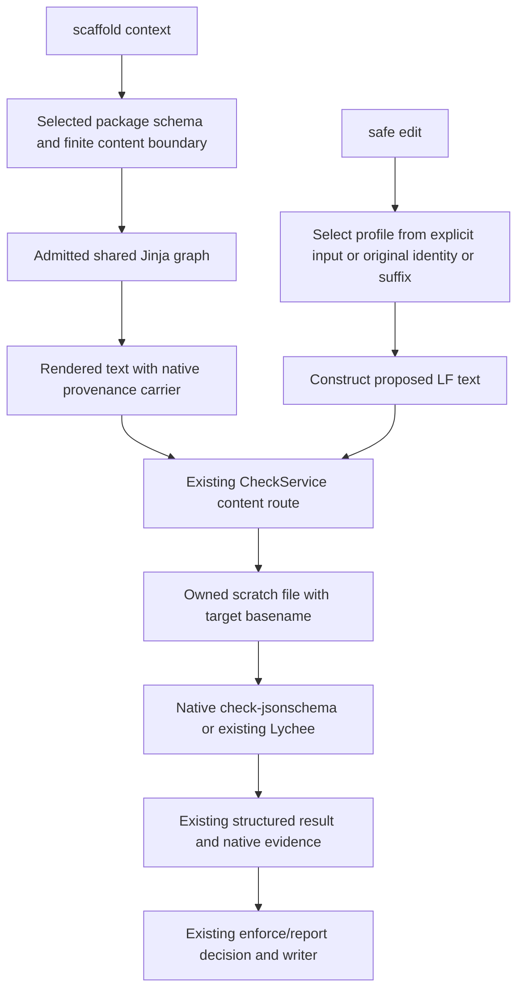

<!-- pgmcp:v1 id=design pv=1.0.0 pf=YApsrGTQgBUKFez2 sf=zJbLuUrs_I33kpX4 -->

# Issue 465 — YAML, JSON Schema, ADR and SAD design

**Status:** Design complete — independent review pending  
**Version:** 0.1  
**Last Updated:** 2026-10-11

## Purpose

Define implementable contracts for #465, #484 and #498 without changing the approved strategy or adding a new authoring architecture.

## Scope In

Four package contracts, reachable shared Jinja dependencies, one generic YAML serializer, bounded JSON Schema provenance recognition, one native check-jsonschema adapter and its configured checks, targeted documentation and behavior evidence.

## Scope Out

Implementation steps, cycle sequencing, legacy aliases, old seed restoration, unrestricted YAML/JSON generation, consumer business rules in adapters, automatic ADR numbering/lifecycle/synchronization, runtime template-structure enforcement and a new release workflow.

## Prerequisites

- Research v0.6 and its owner-approved strategies are binding.
- Independent QA gave GO for Research → Design on d24c98950754eb52e19bc6fb5d5f582ed8ecc95f; no blocking findings. The review independently confirmed the selected native/source boundaries and pinned arc42 source.
- Candidate execution remains an Implementation/Validation obligation; this Design claims source-supported feasibility only.

## Problem Statement

The admitted suite lacks supported ordinary YAML, JSON Schema source, ADR and arc42 SAD packages. The new families need reliable native framing and configured pre-write evidence, while reusing the existing catalog, content/provenance envelope, public tools and Markdown tiers.

## Functional Requirements

- #465: scaffold one mapping-root ordinary YAML configuration from finite JSON-shaped content; preserve generated key/value types and text; support configured native checking and normal safe editing.
- #484: scaffold object-based Draft 2020-12 JSON Schema source with a valid persisted pgmcp identity, without a Markdown creation workaround; preserve automatic edit-profile recognition through bounded $comment reading.
- #498: deliver separate adr and sad packages on existing Markdown tiers; use visible caller-owned ADR identity/status, explicit links, twelve ordered arc42 sections and proportional drafts.
- Bind one native check-jsonschema adapter to distinct YAML instance-schema, JSON Schema envelope and metaschema checks; leave consumer-specific admission to consumers.
- Admit subsequent package-only extensions through existing manifest/schema/policy/graph discovery after generic capabilities exist.

## Nonfunctional Requirements

- No artifact IDs, application fields, workphase names or workspace paths in generic renderer, reader or check orchestration.
- Reuse existing immutable DTOs, dependency injection, operation failures and configured presentation; no new tool surface or execution protocol.
- Keep text framing in Jinja assets and dependency/rule selection in the owning package or workspace configuration.
- Use real delivered graphs, public interfaces and isolated temporary workspaces for focused behavior evidence. No whole-artifact snapshots or tests whose purpose is rejecting retired behavior.

## Constraints

- Preserve supported existing package contracts and existing comment carriers; new families have no legacy aliases or compatibility bridge.
- Each new package owns manifest.yaml, .version, policy.yaml, context.schema.json and template.jinja2; initial authored package release version is 1.0.0.
- Native metaschema validity, generic YAML parse acceptance and template-consumer admission are different guarantees.
- All ADR/SAD common parent reads must be declared in their context schemas; Jinja inheritance does not inherit a JSON Schema.
- Only the active feature Validation contract owns the full native-configured suite; Design adds no test runs or implementation claims.

## Options

### 1. Package assets plus two bounded generic capabilities

Selected: real PyYAML emission, a JSON framing block and bounded reader extension, with native checks through the existing execution layer.

**Pros:**

- Fits the approved shared boundaries.
- Keeps all application/document field knowledge in packages and schemas.

**Cons:**

- Requires explicit native parser prerequisites and small shared-root impact review.

### 2. Handwritten YAML interpolation or adapter-owned schema validation

Rejected: duplicate parser/scalar/schema knowledge.

**Cons:**

- Unreliable escaping and consumer semantics.
- Crosses the adapter and rendering responsibility boundaries.

### 3. Explicit-only JSON template selection

Rejected by the owner's provenance decision.

**Cons:**

- Does not retain automatic identity-based profile selection.

### 4. New document lifecycle, custom directory discovery or template compliance engine

Excluded: separate concerns beyond this issue.

**Cons:**

- Adds orchestration and hidden behavior without a present requirement.

## Decision

Implement yaml_configuration, json_schema, adr and sad through existing package discovery. Add toyaml to the real filter vocabulary and one generic artifact_frame override in tier0_root for valid JSON framing. Extend ArtifactHeaderReader.read without changing its interface. Use one check_jsonschema check/v1 adapter with separately configured native obligations.

## Rationale

The package boundary already owns schema, purpose, policy and rendering; both write operations already share content checking. The additions cover missing language framing/emission and native integration, rather than creating parallel authoring services.

## Production Design

| Owner | Contract/change | Existing seam |
|---|---|---|
| Generic YAML emission | Public pure serializer in mcp_server/services/yaml_serialization.py; register filter toyaml in the real admission/render vocabulary. | [TemplateEngine](../../../mcp_server/services/template_engine.py) and [real delivered fixture](../../../tests/mcp_server/fixtures/delivered_templates.py) |
| Shared Jinja framing | Add artifact_frame around the current default comment/body framing; JSON base overrides that block only. Root still owns final boundary normalization and one LF. | [tier0_root](../../../.pgmcp/template_suite/shared/templates/bases/tier0_root.jinja2) |
| Provenance reading | Recognize the first root $comment string in a bounded opening prefix; validate the same record/model and return current result states. | [reader](../../../mcp_server/services/artifact_header_reader.py), [identity](../../../mcp_server/schemas/template_identity.py) |
| Package assets/config | Four closed context envelopes and configured policy/root entries. Data nested in YAML/schema fields remains caller-owned. | [catalog](../../../mcp_server/services/template_catalog.py), [artifact roots](../../../.pgmcp/config/artifacts.yaml) |
| Native adapter | New bundled check_jsonschema package; two selection policies/capabilities and three configured obligations. | [check/v1](../../../mcp_server/execution/contracts/check_v1.schema.json), [capabilities](../../../mcp_server/config/schemas/adapter_manifest.py) |
| Write operations | Reuse original-profile selection, proposed-content checking, enforce/report and checked/create-only writers. No new dispatch. | [profile selection](../../../mcp_server/services/edit_construction.py), [CheckService](../../../mcp_server/execution/check_service.py) |

## Test Design

| Behavior obligation | Public seam / reused evidence | Proportionate coverage |
|---|---|---|
| YAML supported data and comments | Real delivered template graph; yaml.safe_load and actual native checker. | One minimal and one populated context covering false/zero/null, empty containers, nested records, ambiguous string spellings, dotted/Unicode keys and multiline/CR text. Parsed equality is the assertion. Compact invalid context cases; no field-by-field prose snapshots. |
| JSON Schema source and real consumption | Same delivered fixture, json.loads, native shape/metaschema checks and public TemplateContractLoader.load_context_schema. | Minimal/populated source, canonical identity, $id in an appropriate native contract, a generated contained template schema and representative accepted/rejected instances. Native format acceptance stays separate from stricter consumer rejection. |
| ADR/SAD useful structure | Existing shared document tests plus actual adr/sad graphs. | Minimal and populated per package, ordered option consumption, visible supplied identity/status, empty/absent optional carriers, twelve headings/10.1/10.2, perspective and index. Compact closed-record/status/required-field invalid cases. No full output snapshots. |
| Bounded provenance recognition | Adapt test_artifact_header_reader.py and test_edit_construction.py through public read/select_profile. | JSON normal/max/escaped identity, permitted leading framing/BOM/CRLF, overflow/malformed/ordinary comment and later-body marker cases; recognized original selects the current profile. Reuse existing supported comment vectors rather than adding a legacy rejection suite. |
| Native adapter protocol and actual checks | Existing adapter_process/process-runtime public fixtures; new tests/mcp_server/integration/adapters/test_check_jsonschema.py. | Both capabilities/routes, all three bindings, passed/failed/usage/dependency outcomes with evidence, empty/directory refusal, scratch-vs-original input and caller/configured argument provenance. Real native samples are required, not only fake process responses. |
| Persistence policy | Adapt existing public scaffold/edit composition helpers; one focused native data-mutation module. | Valid creation, failed enforce leaves disk unchanged, failed report records findings while following existing write policy, JSON metadata selects the right edit checks, no unintended neighboring writes. Reuse shared cancellation/race tests; do not duplicate their matrices. |
| Cross-document relationships | Reuse native Markdown mutation composition in an isolated workspace with both new packages. | One real ADR/SAD linked pair with actual relative fragments and one broken reference; verify via Lychee. No automatic discovery or fabricated synchronization. |
| Package-only extension and release claim | Delivered-template helper/general catalog public API and existing package maintenance procedure. | One temporary package reusing the new generic YAML capability, no Python registration; effective nested-field consumption review plus real emitted examples and source-bound evidence. |

Keep durable additions in two family modules (data artifacts; architecture records), one native adapter module and one focused data-mutation module; adapt existing reader/selection/shared fixtures as needed. This is an organizational ceiling for the planned surface, not a case-count gate. Consolidate overlapping cases. Tests use tmp_path, frozen data and public methods; never read/write the live .pgmcp/deliverables.json. No new regression/compatibility tests for old formats or an asserted source-line/package inventory just to prove cleanup.

## Contracts

### Package inventory and shared graph

| ID | Caller envelope | Graph | Output profile |
|---|---|---|---|
| yaml_configuration | Required data object; optional header_comment string. No document metadata. | template → new shared/templates/bases/tier1_yaml.jinja2 → tier0_root; body uses toyaml. | yaml_configuration_review |
| json_schema | Required schema object; no authored provenance or document metadata. | template → new shared/templates/bases/tier1_json_object.jinja2 → tier0_root. | json_schema_review |
| adr | Required title, adr_id, document_metadata and core decision carriers. | template → existing tier2_markdown_document → tier1_document → tier0_root; existing section/link patterns. | markdown_link_review |
| sad | Required title, document_metadata, architecture_scope and twelve chapter carriers. | Same existing Markdown graph and patterns. | markdown_link_review |

All policies use persistence: workspace. ADR/SAD directly reuse shared document-metadata.schema.json and link.schema.json; package-local records stay in local $defs. Both schemas declare optional purpose, scope_in, scope_out, prerequisites and related_docs because the inherited Markdown base reads them. Existing architecture remains its separate concept-document package.

Location defaults are workspace-owned: yaml_configuration → config; json_schema → schemas; adr → docs/architecture/decisions; sad → docs/architecture. Add appropriate configured authoring roots: YAML .pgmcp/config, locales, .github and mcp_server/bundled_adapters; JSON Schema .pgmcp/template_suite, mcp_server/execution/contracts and .pgmcp/config/check_schemas. Admit .pgmcp/temp for all four demonstration artifacts and docs/development for ADR/SAD. Owners of other workspaces may configure roots; the existing explicit force_target route remains available. Do not add a new permission mechanism or global write ban.

### YAML context and emission

| Input | Contract |
|---|---|
| data | Required object with arbitrary string keys and nested finite JSON values; {} is valid. The existing strict finite boundary owns value admission. |
| header_comment | Optional string; multiline content is prefixed as comments on every line. Omission emits no authored comment; an explicit empty string emits an empty comment carrier. |
| Extra envelope fields | Rejected by the package schema; no name field or application-specific required keys. |

Public pure signature: yaml_text(value: Mapping[str, JsonValue]) -> str. Register as toyaml through register_template_filters(environment), before both admission and rendering. No filesystem/config loading, native process calls or additional renderer namespace.

Use the existing PyYAML SafeDumper, with a string representer as a supported library extension: quote ordinary strings and string keys; use literal block style for multiline string values only when their character content permits lossless YAML block emission. Values containing carriage returns/control characters retain quoted escapes. Let PyYAML own escaping and scalar/chomping rules; no manual quote replacement. Use block collections, insertion order, Unicode, two-space indentation and LF. Do not inject anchors or a per-entry comment model. The library owns empty collections, booleans, null and numeric spelling. Keep generated semantic values separate from the header comment.

Use PyYAML 6.0.3 as the server's declared emission baseline, pinned in the existing distribution dependency. Both server configuration loading and emission use that same installed library. Parsed round-trip equality through PyYAML and selected native checking is required evidence, not a claim based on emitter API inspection.

The YAML output schema checks a mapping root through the native parser. It does not certify original YAML key types, PyYAML/ruamel equivalence for arbitrary edits, finite scalar membership or consumer settings. Reliable emitted finite data comes from the context boundary/serializer; hand-edited configuration semantics remain with the appropriate consumer or configured consumer schema.

### JSON Schema source envelope and valid JSON framing

The closed context has one required schema object. That object must declare $schema exactly https://json-schema.org/draft/2020-12/schema. Its other schema vocabulary/annotations remain data, including $id, $defs, nested Boolean schemas and recursive authored $refs. These values are not the package context schema's own resolver graph.

Reserve the root schema object's $comment for server provenance: caller input of that root property is rejected by a false property schema. Authored description and nested $comment annotations remain admitted. No silent overwrite of a caller's comment.

tier0_root gains a generic overridable artifact_frame block enclosing its existing comment/body layout. The new JSON object base overrides it with an object opening, the first $comment property, a required json_members block and object closing. The concrete schema template emits its root members through existing tojson for keys and values. This preserves the first carrier even when caller members such as $anchor sort before $comment; do not rely on Jinja tojson's default key sorting for identity placement. Reuse provenance_fields from the root and tojson for its JSON string escaping. Do not add a JSON serializer, whole-document JSON parsing in Jinja, or alter global JSON sorting policy.

Generated JSON is UTF-8 with one terminal LF. No native comment or Markdown H1 is emitted. The two JSON output obligations preserve the selected source-family envelope during safe edits and separately validate schema vocabulary. They do not enforce that every edit retains provenance or complies with the originating template's full structure; that general concern stays deferred.

### Bounded reader contract

Existing public interface and immutable HeaderReadResult remain unchanged:

```python
def read(self, content: str) -> HeaderReadResult: ...
```

| Route | Recognition budget and behavior |
|---|---|
| Existing HTML/hash/slash comments | Keep the current complete first-line carrier and 100-character bound, with its existing BOM/CRLF handling. |
| JSON opening carrier | Inspect at most a 512-character opening frame plus overflow/BOM lookahead. After an optional leading BOM and JSON whitespace, require a root object whose first member is the literal $comment key. Decode only its bounded JSON string token; require the following comma or closing brace inside the budget. No search through later root members or body. |
| Record | Use the same ordered pgmcp:v1 id=… pv=… pf=… sf=… record and ArtifactIdentity validation. The decoded record is bounded at the existing maximal 91 characters. JSON escaping must not change the decoded identity. |
| Result | Complete canonical known/unknown package identities are RECOGNIZED; selection remains the consumer's responsibility. Ordinary/non-pgmcp $comment, missing first carrier or later-body markers are ABSENT. A pgmcp-looking first carrier with invalid framing, record or overflow is INVALID. No exception leaks for malformed carrier syntax. |

The JSON frame has a separate budget because JSON escaping can expand a permitted 24-character template ID to 288 ASCII characters; the unchanged maximum logical record plus framing still fits 512. Do not widen all comment lines to solve this. A successfully decoded identity is generation metadata, never authorization, authenticity or proof that the remaining JSON is valid.

select_profile continues explicit template ID → recognized original identity → configured longest suffix. It never reads proposed content to choose a weaker profile. Unknown/invalid/absent metadata retains the current fallback facts; no new DTO, presenter branch or artifact-ID check is needed.

### ADR authored contract

Reuse required document_metadata. Its status is the single ADR decision-record status; refine that existing property in this package to the closed values draft, proposed, accepted, rejected, superseded, deprecated. Do not add adr_status or a state machine. Supplied accepted is authored text, not workflow/QA approval; status does not cause server actions or certify completeness.

| Field | Required/type/meaning |
|---|---|
| title, adr_id | Required nonempty strings. H1 uses title; body renders the caller-owned adr_id visibly. No numbering/prefix transformation. |
| context, decision, rationale, consequences | Required prose strings, including empty draft carriers. Render separate core sections. |
| decision_drivers | Required ordered nonempty-string list; [] allowed. |
| options | Required ordered list; [] allowed. Each closed Option has name: nonempty string, description: prose; optional pros/cons string lists. |
| participants, tags | Optional ordered string lists; no domain taxonomy. |
| verification | Optional prose. |
| sad_sections, supersedes, superseded_by | Optional arrays of existing Link objects with label/target. No automatic relationship inference. |

Optional omission hides the relevant carrier; explicit empty prose/list retains its heading/label without invented findings. Keep supplied alternatives separate and preserve order; do not alias name/title. Core empty carriers make a usable draft, not a finished decision. All field consumption and schema refinement remain package-owned.

### SAD authored contract and arc42 attribution

Required architecture_scope is existing, proposed or mixed, rendered visibly once. Mixed documents require human-authored local distinctions in the chapter content; no static semantic enforcement is claimed.

| Order / fixed heading | Required content field |
|---|---|
| 1. Introduction and Goals | introduction_and_goals: prose |
| 2. Architecture Constraints | architecture_constraints: prose |
| 3. Context and Scope | context_and_scope: prose |
| 4. Solution Strategy | solution_strategy: prose |
| 5. Building Block View | building_block_view: prose |
| 6. Runtime View | runtime_view: prose |
| 7. Deployment View | deployment_view: prose |
| 8. Cross-cutting Concepts | crosscutting_concepts: prose |
| 9. Architecture Decisions | architecture_decisions: closed {overview: prose, adrs: AdrReference[]} |
| 10. Quality Requirements | quality_requirements: closed {overview: prose, scenarios: QualityScenario[]} |
| 11. Risks and Technical Debts | risks_and_technical_debt: prose |
| 12. Glossary | glossary: prose |

All prose accepts an explicit empty string; arrays accept []. Every chapter remains visible in fixed order, including 10.1 Quality Requirements Overview and 10.2 Quality Scenarios. Prose may contain authored Markdown/diagrams/tables; do not require technology, framework or pgmcp workflow vocabulary.

AdrReference is closed {adr_id: Text, status: Text, link: Link}. link.label supplies the ADR title; nested Link avoids extending the closed shared Link object with foreign fields. Section 9 emits a compact ID/status/link index, not a copy of decision rationale. QualityScenario is closed {name: Text, scenario: prose, response_measure: prose}; all three are required, with empty prose permitted for drafts.

ADR-to-SAD targets are caller-supplied actual heading fragments, for example #5-building-block-view. Native Lychee checks paths/fragments; no new anchor encoder, discovery or synchronization.

Adapt arc42 9.0-EN, July 2025 at source 32fd461c91b184777e14f7d66b4e46db936fd3e5. Keep the exact pinned upstream LICENSE.txt notice and attribution/source/change notes as non-rendered Jinja comments in the owning SAD template source and add a short visible attribution at the end of document_body, before the inherited terminal history. Preserve CC BY-SA 4.0 for the distributed adaptation and identify authored architecture content separately. Do not override document_after or remove shared history. The component attribution is source-bound release evidence, not a new lifecycle mechanism.

### Native adapter and check configuration

New bundled adapter check_jsonschema 1.0.0 owns manifest.yaml, check.py, dependencies.json and requirements.txt. Use the existing Python entrypoint with check/v1; native invocation uses that adapter interpreter's sys.executable -m check_jsonschema. No shell, PATH-resolved secondary Python, pgmcp service imports, schema/resource wire field or generic execution-model change.

Declare two capabilities, yaml_configuration and json_schema. Both inputs are [content, selection] with requires_file: true; configured_targets respectively yaml_sources and json_schema_sources. File-content requests carry existing operation, target_path, input_path, args and execution_context; selection requests carry operation, targets, args and execution_context. ContentInputPreparer already preserves the target basename/suffix and exact bytes. Never read/check the original target instead of the proposed input_path.

requirements.txt is the single authoritative version list: check-jsonschema==0.38.2, orjson==3.13.0, ruamel.yaml==0.18.16, jsonschema==4.25.1. The adapter-owned dependencies.json identifies the native module and refers to that requirements file without repeating versions. The adapter reads those exact pins for distribution-version/importability admission in its own interpreter. Installation uses the same requirements file; no generated installer, generic dependency service or duplicate runtime pin map. This is a supported parser/checker baseline, not a full transitive lock or a proven runtime combination. jsonschema is also a server dependency in the same interpreter; its admitted baseline therefore affects that existing consumer boundary and requires the normal full-suite Validation evidence. Preserve actual identities in external_tools. Missing/mismatched prerequisites are unavailable; never fall back silently to json.loads.

| Check ID / capability | Configured native default_args | Profile |
|---|---|---|
| yaml_configuration / yaml_configuration | --schemafile .pgmcp/config/check_schemas/yaml_configuration.schema.json --force-filetype yaml --output-format JSON | yaml_configuration_review |
| json_schema_shape / json_schema | --schemafile .pgmcp/config/check_schemas/json_schema_source.schema.json --force-filetype json --output-format JSON | json_schema_review |
| json_schema_metaschema / json_schema | --check-metaschema --force-filetype json --output-format JSON | json_schema_review |

Use timeout_seconds: 60 for these bindings; normal caller timeout overrides retain their current meaning. yaml_configuration.schema.json is a Draft 2020-12 mapping-root schema, with no application fields. json_schema_source.schema.json requires an object root and exact $schema URI, without banning valid schema keywords or requiring template provenance. Both are native instance schemas loaded relative to workspace cwd; they are not template context schemas. Metaschema alone chooses the authored dialect and therefore cannot replace the envelope check. Do not add another tool to express that distinction.

Extension bindings: .yaml and .yml → yaml_configuration_review; .schema.json → json_schema_review. No global .json metaschema profile. Keep run_checks.default_profile: python_review unchanged.

Branch policies use include: ["**/*.yaml", "**/*.yml"] or include: ["**/*.schema.json"] respectively. Both use workspace-authored exclude patterns [".pgmcp/temp/**", "docs/development/archive/**", "**/__pycache__/**", "**/.pytest_cache*/**", "**/.venv/**", "**/venv/**", "**/node_modules/**", "build/**", "dist/**", "**/*.egg-info/**"]. The current generic configured-target filter owns branch preselection; explicit file targets remain deliberate and bypass that policy. No force-exclude semantics or adapter-owned application exclusion list.

### Native selection, read-only boundary and result semantics

The pinned CLI accepts literal file operands, not directories or globs, and requires at least one instance. Preserve that limitation: branch and explicit-file targeting are supported directly. Directory/workspace inputs and configured scope without native file operands return the existing unsupported-input/native-usage outcome; no hidden traversal, invented file list or empty pass. Configured scope can work when its native args explicitly contain files. Content args must not add positional instances or stdin: the adapter owns the proposed file operand. Native flags retain their tool meanings; do not add adapter-owned schema rules.

The existing default configured Python profile and full configured test suite remain the workspace-wide baseline. YAML/schema verification additionally uses correctly filtered branch files and explicit emitted artifact files. Do not put these flags-only bindings into a configured aggregate that would then lack instance files. Planning must make this exact scope selection executable.

Reject nonchecking help/version modes, stdin replacement and arbitrary native validator-class imports at the read-only adapter boundary; do not silently execute caller-supplied validation code. Keep output capture on stdout/stderr and schema selection native. No data-transform/default-filling for proposed content: pre-write evidence must concern the actual proposed data rather than a transformed copy. No checks write workspace artifacts or normalize content.

| Native observation | check/v1 result |
|---|---|
| Exit 0 and complete native ok report | passed, actual external_tools, native JSON evidence. |
| Exit 1 and complete fail report with errors/parse_errors | failed with substantive native diagnostics and retained JSON report. |
| Click/native usage error | unavailable/unsupported_input with native text; not malformed adapter-wire invalid_request. |
| Schema load/config/ref-resolution error without complete report | unavailable/invalid_configuration or execution_error, preserving stdout/stderr. Never an ordinary artifact failure or pass. |
| Missing/mismatched native dependencies | unavailable/dependency_unavailable. |
| Invalid wire fields/types | Existing invalid_request details and adapter exit 2. |
| Timeout/cancellation/output bound/termination uncertainty | Existing runtime result/capture; no adapter-owned timeout engine. |

Use JSON evidence when the native report is complete; retain text evidence when stderr or another native error path is material. A selection response may report coverage: null and required_targets: [] rather than fabricating coverage. A passed check does not claim referenced-schema availability, application semantics or template completion. Native parser normalization and numeric limitations remain disclosed; consumer evidence uses the real consumer boundary.

### Distribution, documentation and evidence ownership

Existing release assets already include complete .pgmcp/config and template_suite roots, and setuptools includes bundled_adapters. Verify the two new native schemas and arc42 component files are actually present in assembled assets; no artifact-ID-specific release dispatch is required. Native CLI dependencies stay explicit adapter prerequisites, not an automatic installer or a new server bootstrap step.

Update the active provenance/scaffold references to explain JSON's opening $comment exception to first-physical-line comments. Update the existing execution-adapter/native-prerequisite and template usage references only for the new routes, supported scope and guarantees. Use the established package maintenance/release procedure for whole-contract review, minimal/populated/native evidence and source-bound independent review. Record separate outcomes for #465, #484 and #498 in one compact issue Validation report; cache IDs are supplementary, never sole proof.

Shared root changes alter generation fingerprints for dependent packages; they do not rewrite existing artifacts. Restarts use the supported server tool to resolve the immutable new suite/config snapshot. Keep the existing renewal/owner-led adoption route and existing supported contracts; no automatic migration, compatibility bridge or stale-catalog workaround.

## Flow



## State and Failures

No new workflow state, document registry, ADR completion register or lifecycle state is introduced. Configuration/profile/package admission remains startup-owned. Context rejection returns the existing schema feedback; serializer/render failure uses the existing render_failed boundary. Invalid carrier data returns current reader states and selection facts. Native unavailable/failed results remain visible and preserve the existing enforce/report mutation semantics, cancellation stop conditions, original-byte protection and scratch cleanup. Policy guidance belongs in presentation configuration; native/system diagnostics remain evidence under Architecture §15.1.

## Preservation

Preserve current architecture and other supported package input/output contracts; existing comment carriers and public tool DTOs remain active contracts, not compatibility bridges. New package contexts accept no old seed or Ypsia aliases. Existing quality profile defaults and workflow contracts remain unchanged. Keep artifacts and evidence isolated from workspace planning/state files.

## Transition and Cleanup

No migrations or historical-commit rewrites. Install declared native prerequisites in the interpreter used by the adapter, adopt the new source suite/config through the current upgrade/renewal route and restart normally. Native checks may be unavailable before prerequisites are installed; never describe that as validation success. Do not repair unrelated archived examples or expand instruction files.

## Validation

### \#465 YAML authoring result

**Method:** Run the focused delivered-family and native mutation evidence using the declared parser environment; demonstrate minimal/populated YAML, real PyYAML consumer parsing and temporary suite-only extension.

**Expected Result:** Supported generated data retain intended types/text; native outcomes and policy are observable; configured checks do not claim application semantics.

### \#484 schema-source result

**Method:** Parse output; run both configured native shape/metaschema checks; recognize identity with the real reader; load a compatible generated schema through the real consumer and validate representative instances.

**Expected Result:** Valid JSON, exact source-family dialect/root, automatic provenance selection and distinct native/consumer evidence; no Markdown workaround.

### \#498 architecture-record result

**Method:** Render minimal/populated ADR/SAD, review effective fields through their actual Markdown graph and validate a real linked pair with Lychee. Inspect pinned-source attribution and assembled component files.

**Expected Result:** Meaningful supplied identity/status/options and twelve ordered chapters; valid explicit references; original architecture contract and terminal shared history retained.

### Workflow-wide evidence

**Method:** At the owning Validation phase run one full run_tests(scope='configured') with a sufficient timeout, type-appropriate branch gates and the existing configured Python profile. Apply new native checks to filtered literal files/emitted samples; reuse fresh evidence.

**Expected Result:** Complete required suite/gates and separate per-issue results. Unavailable/timeouts/skips are explicit, not pass. Do not send mixed Markdown/JSON targets to Python checks or empty configured targets to a files-required checker.

## Risks

### Native parser success is mistaken for consumer equivalence.

Quote generated strings and prove semantic round trips at the real consumer. Disclose ruamel key/timestamp normalization, numeric/parser limits and native schema-reference limits.

**Consequence:** A mapping/schema can be formally accepted yet rejected or interpreted differently by its consumer.

### JSON provenance framing expands a shared root or reader into a schema engine.

One artifact_frame block, existing record/model and bounded opening-string recognition; native checks validate the remaining document.

**Consequence:** Whole-document scanning, artifact dispatch or app-schema knowledge would violate the approved boundary.

### Native scope/default arguments cannot supply instance files.

Files-only check routing, explicit unsupported outcomes for directory/empty input, correct branch filtering and separate baseline configured verification.

**Consequence:** A flags-only configured native call is unavailable, never evidence of a workspace-wide pass.

### Dependency declaration and installation pins drift.

Keep exact version pins only in requirements.txt and refer to that file from the adapter's dependency descriptor. Verify its admitted versions/importability in the actual adapter interpreter, not a PATH CLI.

**Consequence:** Permissive JSON fallback or changed native defaults could invalidate evidence.

### Shared-tier reads, empty drafts or attribution bypass metadata/history.

Declare all inherited optional inputs, reuse shared refs/patterns, retain terminal history and put source attribution in SAD body. Review minimal and populated graphs.

**Consequence:** Admission failure or structurally incomplete/fabricated documents.

## Implementation Integration Clarification

The cold whole-suite admission exposed that auxiliary `.txt` files are rejected by the existing strict generation-source inventory. The component license and source/change notices therefore live in a non-rendered Jinja comment in `sad/template.jinja2`; their exact upstream text and package co-location are preserved. The visible document attribution is unchanged. This corrects the originally named auxiliary-file placement without adding source-inventory exceptions or changing the Approved Strategy. Validation must inspect that owning source in the assembled assets and repeat normal server admission.

## Planning Consequences

Plan bounded deliverables for generic emission/framing/reader, package assets, native adapter/configuration and per-issue evidence; do not sequence cycles here. Admit native prerequisites before evidence is needed. Reserve workspace-wide suite/gates for Validation, select literal targets per check type and avoid an empty configured invocation for the new files-required checker. Shared-root input/graph coverage and transient fixture isolation are mandatory. Keep release evidence compact and traceable. No unresolved owner strategy choice remains; implementation evidence may expose a design defect and must trigger an explicit reassessment rather than a silent strategy change.

## Sources

- [Shared Markdown tier](<../../../.pgmcp/template_suite/shared/templates/bases/tier2_markdown_document.jinja2>)
- [Shared link schema](<../../../.pgmcp/template_suite/shared/definitions/link.schema.json>)
- [Artifact header reader](<../../../mcp_server/services/artifact_header_reader.py>)
- [Native content preparation](<../../../mcp_server/execution/content_input.py>)
- [Process workspace cwd](<../../../mcp_server/execution/process_runtime.py>)
- [Existing native Python-interpreter adapter](<../../../mcp_server/bundled_adapters/mypy/check.py>)
- [Native checker CLI source 0.38.2](<https://github.com/python-jsonschema/check-jsonschema/blob/0.38.2/src/check_jsonschema/cli/main_command.py>)
- [Native JSON parser source 0.38.2](<https://github.com/python-jsonschema/check-jsonschema/blob/0.38.2/src/check_jsonschema/parsers/json_.py>)
- [Native dependency metadata](<https://pypi.org/pypi/check-jsonschema/0.38.2/json>)
- [orjson baseline metadata](<https://pypi.org/pypi/orjson/3.13.0/json>)
- [ruamel baseline metadata](<https://pypi.org/pypi/ruamel.yaml/0.18.16/json>)
- [jsonschema baseline metadata](<https://pypi.org/pypi/jsonschema/4.25.1/json>)
- [Pinned arc42 source](<https://raw.githubusercontent.com/arc42/arc42-template/32fd461c91b184777e14f7d66b4e46db936fd3e5/EN/arc42-template.adoc>)
- [Pinned arc42 license](<https://raw.githubusercontent.com/arc42/arc42-template/32fd461c91b184777e14f7d66b4e46db936fd3e5/LICENSE.txt>)

## Related Documents

- [Approved Research](<research.md>)
- [Architecture contract](<../../coding_standards/ARCHITECTURE_PRINCIPLES.md>)
- [Template maintenance and release procedure](<../schema-template-maintenance.md>)

## Version History

| Version | Date | Author | Changes |
| --- | --- | --- | --- |
| 0.1 | 2026-10-11 | @imp designer | Specify four bounded packages, generic YAML emission and JSON provenance framing, native check bindings and proportional behavior evidence within the approved Research strategy. |
