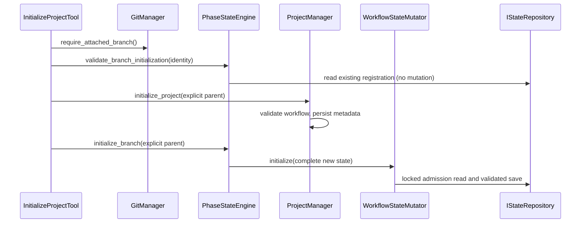

<!-- pgmcp:v1 id=design pv=1.0.0 pf=Uk1D2XWpiag1c6nn sf=KoFPQ3-cAAWFeesb -->

# Issue 503 — explicit registration, state-derived PR targets and non-mutating validation

**Status:** DESIGN — INDEPENDENT REVIEW REQUESTED  
**Version:** 0.2  
**Last Updated:** 2026-10-15

## Purpose

Specify the smallest coherent contract change inside the existing initialization, state, Git and PR seams. Research and its owner-approved scope are binding; this document contains contracts, not implementation bodies or cycle sequencing.

## Scope In

Explicit parent input and actual branch registration; complete state initialization and validated mutation through one injected mutator; exact registration for PR targets; removal of the lower default base; non-mutating source-validation failures in state reads and the two planning-command sites; repository test fidelity and bounded consumer/instruction cleanup.

## Scope Out

New state/recovery/orchestration frameworks, cross-file or cross-process transactions, remote parent discovery, automatic data migration, compatibility bridges, phase/cycle redesign, broad test or warning cleanup, packaging and releases.

## Prerequisites

- Research v1.0 and owner-approved strategy in research.md.
- Independent Research → Design GO on 01d2b5249b576e248aa5277d64927f887b6979aa; owner authorized Design.
- Applicable Architecture Principles: CQS, ISP/LSP, constructor injection, explicit inputs and public behavior tests.

## Problem Statement

Registration identity currently passes through optional input, metadata/reflog inference, placeholder state and unchecked copies. PR preparation and creation can use different heads and fallback bases. Invalid-source reads or failed planning commands can quarantine whole files, changing later observations. In-memory test storage does not reproduce filesystem handover/absence semantics.

## Functional Requirements

- Require explicit nonblank parent input; observe the attached worktree branch; reject identity/state preconditions before project writes.
- Initialize a complete fresh BranchState and validate ordinary state updates using one existing injected lock boundary.
- Derive submit_pr head/base only from exact matching registered state before submission effects; require base in lower create_pr.
- Preserve original and existing backup bytes on invalid/unreadable state or planning-source preconditions, including indirect planning/status reads.
- Preserve valid different-branch handover, general versus branch-validated readers, configured Ready/admission, ordinary phase/cycle behavior and truthful post-write diagnosis.
- Keep affected test preparation explicit and small; remove obsolete behavior expectations without preserving a legacy route.

## Nonfunctional Requirements

- No Git/file IO in value models; read-only consumers receive read-only interfaces.
- Use current repositories, state engine, mutator, Git manager, wrappers and presenters; no second lifecycle service.
- Production and in-memory repositories express the same current-state storage and absence contract.
- Preserve exception causes/tracebacks through existing wrappers; presentation remains owned by current presenters/configuration.
- Keep verification focused during implementation; the complete configured suite belongs to Validation.

## Constraints

- Clean break at changed DTO, state, internal API and configuration boundaries; no automatic migration or accepted legacy parameters.
- Plan and state writes remain separate. A later failure or external race may leave metadata persisted; no rollback/transaction promise.
- Branch/parent values are validated without trimming, ref rewriting, remote probing or new branch-name conventions.
- Artifact context and method signatures below describe target contracts; production and tests remain unchanged in Design.

## Options

### 1. Complete initialization and ordinary mutation on the existing mutator — selected

Add one explicit initialization operation to the current command seam, inject its existing instance, and use existing read-only state access for submission.

**Pros:**

- One state-write/lock owner; no placeholder callback.
- Small production chain and direct dependency direction.

**Cons:**

- Changed contracts require targeted fixture migration.

### 2. Keep bootstrap callbacks and add defaults/optional compatibility

Continue creating a placeholder and preserve optional parent/head/base inputs.

**Cons:**

- Contradicts the clean break and leaves competing identity authorities.

### 3. New registration service or cross-file prepare/transaction layer

Introduce a new lifecycle orchestrator or generic prepare/persist transaction to combine metadata and state.

**Cons:**

- Larger API, dependency and test surface than the approved early identity/state guarantee requires.

## Decision

Use the existing state engine for registration admission and complete candidate construction, the existing mutator for locked initialization/update, and a composed read-only exact-branch reader for PR authorization. Failed prerequisite validation leaves files untouched. Retire only obsolete structures whose active consumers disappear.

## Production Design

| Owner | Target responsibility / dependency |
| --- | --- |
| InitializeProjectTool | Obtain actual attached branch from GitManager; call the existing engine admission guard; pass the explicit parent to manager and engine. No inference or direct repository access. |
| ProjectManager | Validate workflow/customization, persist project metadata and handle planning writes. Parent becomes a required initialization argument, separate from optional customization. Invalid-source validation propagates before persistence. |
| PhaseStateEngine | Validate configured issue identity and initialization admission; construct a new complete state from explicit identity and project workflow values; use the injected mutator. |
| WorkflowStateMutator | Own one in-process lock for complete initialization and ordinary read/mutate/validate/save. No placeholder creation. |
| BranchState / repositories | Validate pure state values; store one current registration. General reads permit inspection of a different stored branch; exact matching belongs to the existing wrapper. |
| SubmitPRTool | Read matching state through IStateReader, check configured issue identity via directly injected GitConfig, then use its branch/parent for the existing submission chain. |
| GitManager / GitHub calls | GitManager owns attached-branch interpretation. GitHub manager/adapter require explicit base. Current preparation, rollback and status responsibilities remain. |

Bootstrap passes the already constructed WorkflowStateMutator to PhaseStateEngine. The engine dependency is required; its fallback construction and ignored state_reconstructor argument retire. The latter has two test-only keyword callers. No new interface is introduced for attached-branch lookup or PR registration.

The removed PR fallback is the sole production use of GitConfig.default_base_branch. Retire that unconsumed field and its git.yaml value, corresponding active examples and fixture arguments (currently 13 test files). This is deletion of the abandoned target authority, not replacement with another default. No other Git configuration is redesigned.

## Test Design

Use existing tests as behavioral evidence; keep direct registration/DTO/repository/mutator/PR tests direct. Ordinary cycle/context/readback tests may share one small preparation helper in test_support.py using already constructed manager/engine and required keyword identity, including parent. Existing construction factories remain; no generic kwargs builder or production defaults.

| Existing area | Evidence to retain/adapt |
| --- | --- |
| Initialization / state-engine tests | Explicit parent; early invalid/same-branch refusal without metadata write; valid other-branch handover resets old subphase/skip/cycle fields. |
| Repository / mutator tests | Same empty/load-other/replace semantics for file and in-memory; invalid updates/callbacks do not persist; ordinary apply never creates state; lock releases after failure. |
| PR unit and existing atomic integration | Matching stored head/base throughout; unavailable/mismatched/invalid/unreadable registration causes no prepare/push/create/status write; existing success/rollback behavior remains. |
| Existing planning-source matrix | Adapt the two source kinds across three commands to preserve original and prior backup bytes; keep successful persistence and persisted readback facts. |
| Existing selection/context tests | Branch basis is unavailable on exact identity mismatch; other scopes need no parent. Restrict the existing asyncio module mark to the actual async tests. |
| Wiring / weak source assertions | Observe injected mutator use via behavior. Retire Lock/import/source-substring and deleted-private-method assertions where directly touched; retain useful freshness doubles. |

Remove old reflog/cascade/nullable-parent/backup-reset expectations and dedicated tests for retired structures. Do not add tests whose purpose is proving that an old parameter, private method or text fragment stays removed. New-contract rejection paths are tested at their actual public behavior boundary without multiplying schema-content assertions.

A shared helper is never used to hide the inputs in registration-contract tests. Update raw state/request dictionaries, default-base fixture arguments and direct constructor kwargs found by Research. Distinguish branch-state 2.0.0 fixtures from unrelated 1.0.0 config/planning/validator fixtures; no global version-string replacement. No new test file or net growth quota is required by the design.

## Contracts

### Public tool inputs and success output

The public JSON shapes are:

| Tool/model | Required | Optional | Removed |
| --- | --- | --- | --- |
| InitializeProjectInput | issue_number, issue_title, workflow_name, parent_branch | custom_phases, skip_reason | Parent inference. |
| SubmitPRInput | title | body=null, draft=false | head, base. |
| InitializeProjectOutput | Existing success fields plus parent_branch: str | Existing optional output fields | Nullable/defaulted success parent. |

Both input models retain extra="forbid". Parent is a required string with minLength 1 and pure validation rejecting whitespace-only values, whitespace in references and equal parent/head once the actual head is known. No stripping or normalization occurs. Existing workflow enum injection remains on the tool, not the input value model. Input failures continue through the existing schema-feedback path.

No public create_pr tool is invented; the explicit-base change concerns the existing manager/adapter methods.

### Internal initialization and Git contracts

Changed signatures (unchanged dependencies/fields are omitted):

```python
GitManager.require_attached_branch(self) -> str

ProjectManager.initialize_project(
    self, issue_number: int, issue_title: str, workflow_name: str,
    *, parent_branch: str, options: ProjectInitOptions | None = None,
) -> dict[str, Any]

PhaseStateEngine.validate_branch_initialization(
    self, branch: str, issue_number: int, parent_branch: str,
) -> None

PhaseStateEngine.initialize_branch(
    self, branch: str, issue_number: int, initial_phase: str,
    parent_branch: str,
) -> dict[str, Any]

GitHubManager.create_pr(
    self, title: str, body: str, head: str, base: str, draft: bool = False,
) -> dict[str, Any]

GitHubAdapter.create_pr(
    self, title: str, body: str, head: str, base: str, draft: bool = False,
) -> PullRequest
```

require_attached_branch is a query: use the existing adapter's actual branch, reject its detached HEAD sentinel with existing PreflightError, and perform no checkout/fetch/write. get_current_branch and IGitContextReader retain their general contract.

The early engine guard validates reference values, parent != branch and a positive supplied issue equal to GitConfig.extract_issue_number(branch). It rejects existing same-branch state with StateAlreadyExistsError; allows genuine absence or valid different-branch state; and propagates every invalid/unreadable-source failure.

ProjectInitOptions becomes frozen and contains only existing execution/customization fields; parent_branch is removed. ProjectPlan becomes frozen and has required parent_branch before its defaulted fields. Its parent records the supplied value; it is never a fallback authority. A direct manager call validates the supplied reference before persistence. Public orchestration passes the same parent through both stages.

initialize_branch requires its explicit parent to agree with the saved project metadata; disagreement refuses state persistence rather than selecting one silently. Public initialization already supplies the same parent to both. Workflow values come from the stored project; existing initial_phase argument semantics remain. No new prepare-project API is added.

### BranchState and repository contract

BranchState keeps its current field names and top-level frozen/extra-forbid configuration. branch and parent_branch are required nonblank, whitespace-free references; a pure model invariant rejects equality. Existing non-registration field semantics remain, including optional issue_number for general state consumers; initialization supplies a positive matching issue, and PR authorization requires that match.

The branch-state envelope advances to **2.0.0** because making the parent mandatory changes persisted validity. BranchState owns one schema-version constant/default; its validation requires that exact value and FileStateRepository uses that same authority. The deliverables envelope remains 1.0.0: no planning storage shape is changed. Package/release versions are untouched.

with_updates(**updates: object) -> BranchState reconstructs and validates the complete field data plus updates; unknown keys and invalid values fail. It must not use unchecked model_copy. Repository save and mutator candidate admission also validate complete field data rather than assuming model_validate(existing_instance) revalidates under Pydantic defaults.

| Repository operation | File and in-memory contract |
| --- | --- |
| Empty storage load | StateNotFoundError for genuine absence. |
| General load(branch) | Return the one currently stored valid state, even if it names another branch. |
| Save(state) | Validate and replace the current state; filesystem uses the existing atomic writer. |
| BranchValidatedStateReader.load(branch) | Delegate and reject exact branch mismatch with StateBranchMismatchError. |
| Invalid/unreadable file | Propagate diagnosis/cause; original and existing .bak remain unchanged. |

InMemoryStateRepository becomes one BranchState-or-None slot, replacing its branch-keyed dictionary. It must not preserve older A after B replaces the current registration. This aligns the existing test implementation with the filesystem contract, not a new multi-branch state feature. IStateReader/IStateRepository signatures remain unchanged; their docstrings record these semantics. Native I/O/validation failures must not be broadly translated to absence.

### Existing mutator command seam

```python
IWorkflowStateMutator.initialize(self, state: BranchState) -> None
IWorkflowStateMutator.apply(
    self, branch: str, mutate: Callable[[BranchState], BranchState],
) -> None
```

Both operations use the same existing lock and timeout, releasing it on success or failure.

initialize validates the complete candidate and, inside the lock, reloads current storage. Only StateNotFoundError admits fresh storage; a valid different branch admits handover; the same branch raises StateAlreadyExistsError. Invalid/unreadable state propagates. It saves the new state without copying previous fields.

apply requires existing exact-matching state, gives that fresh state to the callback, validates the complete result, and checks that branch, issue_number and parent_branch have not changed before saving. Identity changes and lock conflicts use the existing StateMutationConflictError. Missing state never bootstraps. Existing callback-return freshness behavior is retained.

Complete initialization sets issue/workflow/phase/parent from admitted input and project values. Cycle position/history, transitions and subphase start fresh; skip_reason comes from the new project instead of the previous branch. No old-branch field survives merely because it was omitted from an update.

The early guard protects metadata from deterministic registration refusal; the locked guard protects final state admission. Their repetition is intentional. The lock does not cover project metadata, Git checkout or another process.

### PR authority and branch-check readers

SubmitPRTool receives the existing Git/GitHub/status/readiness dependencies, plus **state_reader: IStateReader** and **git_config: GitConfig**, replacing its parent-only reader dependency. Bootstrap composes BranchValidatedStateReader over the ordinary repository. No write-capable repository or new registration service is injected into the tool.

Submission observes the attached branch, loads matching valid registration, and checks that the configured branch issue is present and equals state.issue_number. The validated state's branch and parent_branch supply head/base to all existing submission calls. Only after these checks may prepare_submission neutralize, commit or push, followed by PR creation/status. Existing read-only enforcement checks may run before execute; this contract forbids lifecycle writes, not all reads.

BranchStateParentReader remains narrow for branch check selection. Missing state, exact branch mismatch or configured issue mismatch returns None and retains branch_parent_missing behavior. Invalid/unreadable state propagates; there is no invalid-parent-to-default conversion. Configured/targets/workspace selection continues to bypass parent lookup. No global matching rule is added to the general repository.

### Errors, source preservation and presentation

| Failure point | Observable result and effects |
| --- | --- |
| Missing/invalid public parent, unsupported input fields | Existing input schema feedback; no initialization/submission writes. |
| Detached branch, invalid issue identity or equal head/parent | Existing PreflightError with factual diagnostic; no project/submission writes. |
| Existing same branch at initialization | StateAlreadyExistsError; early refusal leaves metadata/state unchanged. |
| Missing PR registration / ordinary mutation state | StateNotFoundError; no lifecycle/state write or placeholder. |
| Wrong registered branch | StateBranchMismatchError at read authorization; parent-only check selection returns its existing unavailable result. |
| Corrupt/version-invalid state or planning source | Existing StateCorruptedError/StateVersionMismatchError/PlanningVersionMismatchError; no source move or backup overwrite. |
| Other I/O/model/callback failures | Preserve original type/cause to existing wrappers; no catch treating them as absent or successful. |
| State changes between early guard and final write | Final admission can fail after metadata persistence; no cross-file rollback is claimed. |
| Planning persisted but readback fails | Existing planning_readback_failed and persisted=True remain. |

Remove the automatic backup from FileStateRepository.load and the two existing ProjectManager command catch sites. If no callers remain, remove StateVersionValidator.backup_file, its now-unused logging and dedicated rename tests. Keep the validator's query, structured errors and all unrelated activation/upgrade backup machinery.

Do not add tool-level error DTO construction, exception-dispatch tables or inline presentation templates. Existing capture wrappers retain tracebacks/domain facts, and existing presenters/config own formatting. Reference validation is domain fact validation, not a new presentation policy.

## Flow



PR flow remains the existing preparation/API/status chain, preceded by matching-registration read authorization. Planning/status queries may read both files, but neither read can implicitly quarantine its source.

## State and Failures

State remains the branch-local authority, not inferred from commits or replaced by project metadata. Registration is admitted before deterministic effects; final state admission is locked. Separate files, native validation/read windows and external edits remain separate failure domains. Recovery from invalid old data is deliberate; ordinary queries and failed prerequisite checks leave evidence in place.

## Preservation

| Approved invariant | Design disposition |
| --- | --- |
| One actual head / explicit parent | Existing BranchState.branch, required parent throughout; no caller PR targets. |
| Valid branch handover | General single-slot read plus fresh complete initialization; strict wrapper remains separate. |
| Normal phase/cycle behavior | Existing engine policy and four ordinary mutation callbacks stay; no phase names hardcoded. |
| Planning success and post-write facts | Current write path and persisted=True failure remain; only prerequisite-quarantine disappears. |
| Configured admission / unrelated scopes | Existing enforcement and selection ordering remain. |
| Minimal dependency surface | Existing lock/read interfaces and composition root; no new state/orchestration service. |
| Human-approved clean break | Old DTO fields, inference/default authorities and exhausted compatibility arguments retire. |

## Transition and Cleanup

Perform a clean cutover of contracts and all affected callers; no dual inputs, temporary parent defaults or schema translators. Fresh branches use the new state envelope. For this active development branch, the existing state artifact needs a deliberate, reviewed schema-version update preserving its actual identity and audit content when the new server code is activated; old server code must not be used to mutate the new envelope. Other active workspaces require deliberate repair/update; no installer or migration machinery is added. This is a data-contract change, not a package release. Retire exhausted fallback/config/constructor/backup structures and their tests only after confirming no active consumers remain. Active references and seven Ready examples change in place; historical issue records stay intact.

## Validation

### Registration, repository parity and normal mutation

**Method:** Focused public behavior tests in existing initialization/repository/mutator areas; both storage implementations.

**Expected Result:** Same absence/handover rules, complete initialization, validated stable registration and no failed-candidate writes.

### Submission authority and preserved admission

**Method:** Existing PR unit/atomic integration plus check-selection/context tests with narrow injected external dependencies.

**Expected Result:** Exact state-derived targets; no lifecycle effects on failed authorization; existing Ready/rollback behavior remains.

### Failed-source preservation

**Method:** Existing repository and planning-command invalid-source cases with an existing backup and repeated calls; meaningful indirect plan/status read case.

**Expected Result:** Source and backup bytes remain; repeated calls expose the same invalid source; no implicit absence/reset.

### Quality and final scope

**Method:** Focused checks for changed Python sources/tests and Markdown; complete native-configured suite and required configured checks in Validation under fresh phase instructions.

**Expected Result:** Required gates complete without weakened config, incompatible fixture defaults or broad warning cleanup. No tests or Python gates are executed by this Design artifact.

## Risks

### Candidate validation or an external change can fail after metadata persisted.

Retain the explicit early/final admission limits and diagnose the real failure; no transaction/rollback claim.

### Required parent and state schema cutover affect fixtures and the active server's own workflow artifact.

Use explicit local fixture contracts and a reviewed activation/data cutover; do not run old code against the new state format or add compatibility readers.

### A helper or fake hides registration invariants or reproduces old placeholder logic.

Keep contract tests direct, setup inputs explicit and both repository implementations behaviorally aligned.

### Cleanup drifts into unrelated config, workflows or backup machinery.

Delete only exhausted default-base/constructor/backup structures identified above; activation/upgrade backups and other warnings remain out of scope.

## Planning Consequences

Planning must allocate bounded contract/consumer and test changes, preserve the active-server schema cutover, and identify focused proof per affected boundary. Do not turn all call-site counts into separate deliverables or new tests. Final broad verification belongs to Validation; no release work is authorized. Independent Design review is required before Planning.

## Design Evidence Boundary

Source inspection verified the two existing backup-command sites, current mutator injection gap, single-slot versus branch-keyed repository difference, sole production default_base_branch use and two ignored-constructor test callers. Bounded delegated preflight returned no concrete findings; the producer checked the decisive sources. This is not independent QA authorization.

Document-only verification: run_checks(scope="targets", targets=["docs/development/issue503/design.md"], checks=["markdown_links"], timeout_seconds=120) reported passed, args_source=configured. Final safe_edit_file validation also checks the links. No production/test/config files or live schema data were changed, and no Python checks or tests were executed in Design.

## Sources

- [Approved Research and inventory](<research.md>)
- [State repository/models](<../../../mcp_server/managers/state_repository.py>)
- [State engine](<../../../mcp_server/managers/phase_state_engine.py>)
- [Existing mutation seam](<../../../mcp_server/managers/workflow_state_mutator.py>)
- [Read interfaces](<../../../mcp_server/core/interfaces/state.py>)
- [Mutation interface](<../../../mcp_server/core/interfaces/workflow.py>)
- [Project manager](<../../../mcp_server/managers/project_manager.py>)
- [Initialization tool](<../../../mcp_server/tools/project_tools.py>)
- [PR tool](<../../../mcp_server/tools/pr_tools.py>)
- [Composition root](<../../../mcp_server/bootstrap.py>)
- [Git config](<../../../mcp_server/config/schemas/git_config.py>)
- [Existing test support](<../../../tests/mcp_server/test_support.py>)

## Owner-approved repair contract supplement

C_2 repairs the concrete failures recorded in [Validation](validation.md) under Research's approved amendment. In TransitionPhaseTool.execute and ForcePhaseTransitionTool.execute, retain the existing PhaseEntryError branch and remove PlanningMutationError from that branch. Let the original PlanningMutationError propagate to the already composed ToolErrorHandlerDecorator/capture_exception path. The wrapper already reads MCPError.code and error_params and captures the original traceback; the existing presenter formats that result. Remove the now-unused import.

No method signature, error DTO, wrapper/presenter configuration or registration/state contract changes. No compatibility error_code alias, getattr fallback, per-type code extractor or new error framework. Existing public wrapped normal/forced calls are the evidence boundary; one focused matrix in an existing phase-tool test file proves code/parameters/type/traceback preservation. Retire the obsolete branch-keyed resolver expectation only because an existing exact-branch wrapper test already proves the supported mismatch contract; preserve that evidence.

## Related Documents

- [Issue 503](<https://github.com/MikeyVK/phase-gate-mcp/issues/503>)
- [Architecture Principles](<../../coding_standards/ARCHITECTURE_PRINCIPLES.md>)
- [Documentation Standard](<../../coding_standards/DOCUMENTATION_STANDARD.md>)

## Version History

| Version | Date | Author | Changes |
| --- | --- | --- | --- |
| 0.1 | 2026-10-15 | @imp designer | Specify target responsibilities, concrete contracts, preservation, bounded test architecture and clean cutover within approved Research. |
| 0.2 | 2026-10-15 | @imp planner | Bound the owner-approved existing phase-tool diagnostic repair to the current outer wrapper; no new contract or architecture, C_1 unchanged. |
