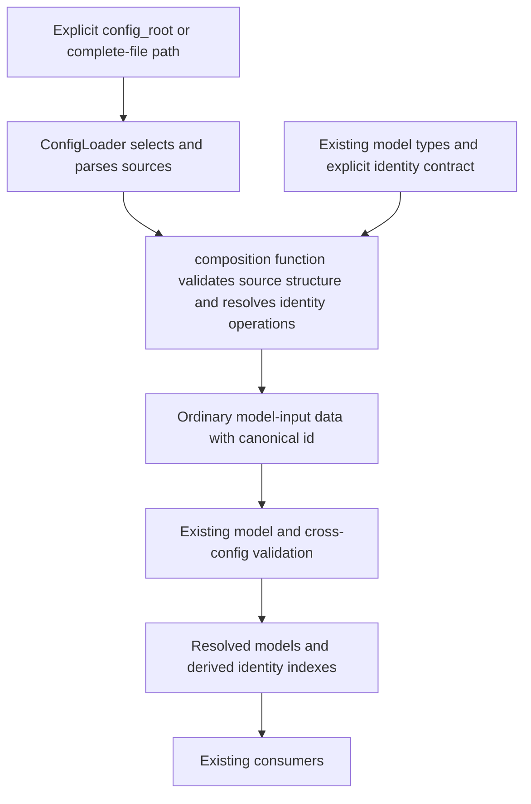

<!-- pgmcp:v1 id=design pv=1.0.0 pf=Uk1D2XWpiag1c6nn sf=KoFPQ3-cAAWFeesb -->

# Issue 504 — Identity-based configuration composition

**Status:** DESIGN REOPENED — RUNTIME REPRESENTATION RESPONSIBILITY UNDER DISCUSSION  
**Version:** 0.4  
**Last Updated:** 2026-10-15

## Purpose

Define the bounded configuration refactor approved in Research: product defaults, explicit workspace differences and one identity contract through directly affected models and consumers.

## Scope In

Workspace configuration, ConfigLoader and a pure generic composition component; directed identity changes and test preparation; github.yaml composition; removal of the temporary init reset; affected documentation and the bounded PR closing-template correction during Documentation.

## Scope Out

Builder or release-manifest changes, distribution/upgrade/adoption mechanisms, releases, #505 reliability, #506/#508 implementation, public state/commit/tool-reference redesign, compatibility aliases, positional patching and tool-specific value-list operations.

## Prerequisites

- Owner-approved Research strategy and the final identity-addressability clarification.
- Existing runtime model validation, direct consumer inventory and focused test seams recorded in Research.

## Owner Review — Superseding Clarification

The owner requested an explicit audit of native Pydantic mutation/merge facilities before further Design work. [The supplemental findings](research.md#pydantic-facilities-and-limits) document model-copy/presence/serialization APIs and pydantic-settings deep merge, with their concrete limits. The target Design remains open; no further architecture or dependency choice follows automatically.

The owner approves $delete as the explicit deletion command. Plain remove: true, empty-value deletion and YAML custom tags are not selected. Identity-based field addressing and literal null semantics remain binding.

The owner questions why the composition feature needs runtime representation distinctions. Distinguish existing consumer implementation from new requirements: ChecksConfig currently uses keyed tuples, WorkflowConfig uses dictionaries and EnforcementConfig uses a list. These are existing model choices, not new configuration semantics.

The earlier draft itself introduced a source/runtime shape difference by selecting canonical source lists with id while insisting on preserving all old runtime containers. That preservation choice is not a reason to add a generic runtime-shape description layer. The composition responsibility is to resolve source objects/fields, not to choose Python containers. Existing model admission already normalizes YAML mappings/lists into typed values.

Runtime consumers need identity lookup and meaningful iteration order. Their particular container spelling is an implementation detail to justify at the model boundary. Keep useful existing indexes where inexpensive, but do not require separate item_model/output metadata or a representation engine merely to preserve them. No runtime-container redesign is approved by this clarification; the responsibility split remains under discussion before further Design work.

Unchanged sections below remain design input. Extra metadata is not selected, and any earlier blanket obligation to preserve every container is superseded by this clarification.

## Problem Statement

The current workspace files combine product policy with repository choices. Anonymous objects and differently named technical identities make targeted overrides ambiguous. Preserve existing operational behavior while defining source ownership, explicit id/order and bounded generic composition. Consumers must not learn layering or rely on an id-to-name preservation adapter.

## Functional Requirements

- Load defaults/<file>.yaml plus optional <file>.yaml from exactly the selected config_root; preserve explicit complete-file and package-owned reads as separate routes.
- Use id as the sole authored technical identity of an addressable object; named fields and nested fields are addressable within it. Nested objects with id are independently addressable within their parent collection.
- Treat elements without their own identity as one containing-field value. Preserve their literal order/duplicates; no argv recognition, set arithmetic or positional selectors.
- Support inherited object additions/field changes and explicit object/field removal without copying unrelated defaults. Keep null distinct from deletion.
- Require explicit source order for complete/new identified objects; inherit order for partial updates; reject duplicate effective sibling IDs/ranks and preserve resolved execution order.
- Carry canonical id through affected models and direct consumers. Keep real display names, external names/numbers and target reference values unchanged.
- Keep configuration_choice:null startup-valid with the established selected-use refusal and safe-edit report behavior.
- Move GitHub identity and the explicit token alternative to github.yaml; normal token delivery remains GITHUB_TOKEN. Keep all registration gates consistent with one resolved integration value.
- Remove init-time acknowledgement rewriting. Correct operative multi-issue PR closing output during Documentation.

## Nonfunctional Requirements

- One configuration-owned generic composition implementation; no dispatch on filenames, tools, workflows or phases, and no registry of bespoke converters.
- Reuse existing domain models/validators; metadata describes identity/representation, not duplicated domain constraints.
- Composition is pure and returns fresh data; loading performs no source writes, backup moves or effective-config persistence.
- Keep production/test impact directed. Adapt existing valuable behavior tests and shared preparation; no content snapshots or old-format regression campaign.
- Diagnostics identify source, object/field path and cause without dumping source documents or secrets.

## Constraints

- Clean break for the changed source and identity contracts: no name aliases, old-flat-root fallback, implicit migration or old-shape fixture converter.
- Preserve ConfigLoader constructor and existing public load entry points. Only the new GitHub load entry point and identity-related model/helper contracts are added/changed.
- ID values remain stable for existing workflow/phase/check/template references; no state migration or commit codec change is justified.
- Physical YAML order is not semantic object order. No implicit append, alphabetical tie-break or automatic rank renumbering.
- Builder inputs stay opaque. This refactor alone does not make an eventual wheel portable or exclude workspace overrides.

## Options

### 1. Whole-list replacement and preserved name contracts

Retain old runtime identity fields and overwrite complete lists in overrides.

**Pros:**

- Less immediate consumer editing.

**Cons:**

- Violates approved targeted identity semantics and inheritance; requires id-to-name preservation mappings. Rejected.

### 2. Per-file transformers or generic patch language

Use handwritten converters, path/index operations or set-like value-list policies.

**Pros:**

- Can express many unrelated transformations.

**Cons:**

- Adds duplicated knowledge and authoring machinery beyond the demonstrated need. Rejected.

### 3. Identity-based composition; metadata proposal reopened

One pure composition function, existing domain models and finite collection metadata. Source id/order determine addressing/ordering; resolved objects retain id.

**Pros:**

- One operation model, visible identity, existing validation and limited direct consumer changes.

**Cons:**

- Requires deliberate source splitting and the inventoried model/test updates. Identity-based composition remains selected; additional metadata is reopened.

## Decision

Select identity-based composition. ConfigLoader owns source selection, file IO and model construction. The composition function owns structural composition and representation. Existing configuration models and ConfigValidator own domain and cross-configuration validity. Additional metadata is no longer selected: determine which facts the model types already supply before adding declarations.

## Rationale

Identity supplies the required mutation boundary. Ordinary field values need no content-aware merge mechanism. Two runtime collection input shapes (ordered sequences and ID-keyed mappings) suffice; existing before-validators already admit mappings for keyed tuples.

## Key Decisions

### Identity defines addressability

The owner's final clarification supersedes type-specific scalar-list handling. No anonymous list element is independently mutated.

### Explicit deletion command; extra metadata not selected

The owner selects $delete. A normal field called remove or delete is not an instruction. Empty values keep their normal data meaning.

Additional item_model/output metadata is not selected. Existing model types and admission behavior must be considered first; structural composition and runtime model representation are separate responsibilities.

### Preserve useful runtime indexes

Source identity remains id in models. Dictionaries/keyed tuples can index the same identity without a second authored name. Index/object mismatches must be rejected by shared identity validation invoked from the affected root models, using their model-declared structure and identity contract rather than filename or field-name dispatch. This applies to direct model admission as well as loader output.

### No extra policy for nonidentified lists

A supplied ordinary field value replaces that field as a whole. The composer never inspects CLI meaning or invents element identifiers.

## Questions

- Explain and settle responsibility for model normalization without introducing a generic runtime-shape translation layer. Existing container forms are not new product requirements.
- Keep the two broad payload areas explicit; they do not by themselves justify per-collection representation metadata.

Deletion spelling is resolved: $delete. No implementation or phase progression is authorized while the remaining design responsibility discussion is open.

## Production Design

| Component | Responsibility | Must not do |
| --- | --- | --- |
| ConfigLoader | Select the explicit sources, parse YAML, invoke composition, construct/validate the model and attach file context to errors | Write sources, discover another root, merge package declarations |
| compose_configuration in config/composition.py | Compose structured fields and identified collections; validate identity/order/operation structure; return model-input data | File/env/Git IO, model instantiation, domain validation or filename dispatch |
| Existing model types / explicit id fields | Authoritative structural and identity information; additional metadata is under reassessment | Infer identity from arbitrary opaque data or duplicate already available facts |
| Existing config schemas | Canonical identity and existing domain constraints/helpers | Source IO or inheritance |
| ConfigValidator | Existing cross-config references/capabilities after model loading | Reimplement composition |
| Bootstrap | Supply one resolved GitHub configuration to manager and token-dependent registrations | Infer owner/repo or probe credentials |
| Runtime consumers | Read resolved models and identity-based indexes | Interpret remove/order directives or combine sources |

No new service container, repository abstraction, mutable registry, config writer or general transformation engine is introduced. New supported structures must fit the generic model/identity contract rather than adding per-file algorithms. A separate collection-metadata layer is not currently selected.

The supported structural vocabulary is named records, declared identified collections and ordinary field values. Named record fields merge recursively; scalar/null/nonidentified sequence values replace. Declared collections merge by id. Existing mapping-valued data keeps its named-key addressing; a key does not make an untyped value an inferred object.

## Test Design

Use the existing config/loader behavior tests for composition and admission. Exercise the public loader, not private helpers. Reuse direct model tests for domain validation and existing manager/tool tests for observed behavior.

| Evidence boundary | Focused handling |
| --- | --- |
| Core composition | A small parameterized public-loader matrix: field inheritance, new/updated/removed IDs, nested addressing, whole-value list replacement, literal null, order and invalid operations |
| Runtime identity | Adapt the existing workflow/contract/issue/policy tests and direct consumer assertions; no duplicate test for every YAML entry |
| Shared preparation | Update test_support._NopGateRunner and affected existing fixtures; separate canonical complete-source creation from overrides explicitly |
| Source isolation | Temporary selected roots and one failure/immutability case prove no live-repository fallback or source writes |
| GitHub composition | Adapt existing Settings/bootstrap tests for workspace identity, env-first token and consistent registration; manager/adapter resolved-value tests stay useful |
| Initialization | Remove reset-only tests; retain a focused fresh-init assertion that no acknowledgement reset occurs and installed unresolved choices come from source defaults |
| Documentation | Adapt existing multiple-issue PR rendering behavior for operative closing lines |

The Research counts are preparation candidates, not a rewrite quota. Direct model fixtures need id only where that model acquires identity; they never acquire remove directives or artificial source order. The obsolete unused workflow_phases fixture may be removed when this already affected fixture is edited. No suite-wide factory rewrite, content snapshot or legacy-rejection campaign.

## Contracts

### 1. Sources and admission

| Route | Sources | Contract |
| --- | --- | --- |
| Normal required workspace config | defaults/<file>.yaml, optional root <file>.yaml | Require a valid complete basis; override can be partial |
| Optional enforcement | Either/both selected-root sources | Neither yields the existing empty policy; workspace-only input must be complete |
| Explicit config_path | Exactly that complete canonical source | No companion lookup; no override directives |
| Adapter/template manifests and policies | Existing explicit package source | No layering or id/order normalization |
| JSON check schemas / release manifest | Existing asset/build route | Not composed by this mechanism |

Absent override inherits. Present empty YAML, non-mapping roots, duplicate keys, unreadable files and malformed data fail. An explicit {} override is a no-op. Use safe YAML parsing and duplicate detection; integer keys remain available only where existing typed maps require them (cycle_exit_requires). Do not globally impose the adapter declaration parser's string-only-key rule on those maps.

Existing version fields remain required where current models require them; overrides may omit them, but cannot contradict the basis version. Unversioned binding declarations remain unversioned. No new version-discovery/fallback mechanism.

Defaults and an override-only optional source must be complete independently. Validate the complete basis through the existing model before applying overrides, then validate the final result. A broken product basis must not be repaired silently by a workspace patch. Typed reference validation remains after complete loaded models exist.

An external config_root is self-contained. There is no fallback to installed assets or the repository. Source documents and parsed inputs are never mutated by composition, including shared YAML-anchor values.

### 2. Addressing and override semantics

| Target | Supplied override | Result |
| --- | --- | --- |
| Named field absent from override | Nothing | Inherit |
| Existing record field | Named child fields | Recursively update those fields |
| Ordinary scalar/null/nonidentified sequence field | A value | Replace complete field value; no element merging |
| Identified collection | Entries with id | Apply each entry to that id; unmentioned objects inherit |
| Existing id | Fields and optional order | Update only supplied fields; inherited fields/order remain |
| New id | Complete object plus order | Add after existing model validation succeeds |
| Existing object | id plus $delete: true only | Remove that object |
| Existing field | {$delete: true} only | Remove the field; model omission/default/required rules then apply |

An id is an exact, nonempty strict string, without case conversion or trimming. Existing narrower ID constraints still apply at domain admission. Identity is unique among siblings; a nested collection is addressed through its parent object/field. Two unrelated collections may use the same id.

id cannot be mutated through a patch; renaming is explicit removal/addition with references corrected. Updating an object can provide all desired fields, but omission never silently deletes an inherited field.

Known schema/model structure determines which collections declare identity. Do not infer object identity from a native payload dictionary that happens to contain an id key. For broad dictionary payloads already supported by optional_label_inputs and phase expectations, declare the containing collection explicitly; retain its ordinary payload fields without guessing nested identities.

An empty identified-collection override supplies zero operations and therefore inherits all entries. Clearing requires explicit removal (individual IDs, or the collection field where omission is valid). An empty ordinary list replaces the field with an empty list. This follows identity addressability, not the contents or tool meaning.

### 3. Canonical values and approved deletion command

Complete source and partial overrides retain their identity-based form. Literal clearing remains separate: default_args: [] stores an empty list; configuration_choice: null stores null.

The owner approves an explicitly reserved command:

```yaml
enforcement:
  - id: open_pr_lock
    $delete: true
```

```yaml
run_checks:
  default_profile:
    $delete: true
```

Object deletion contains only id/$delete; field deletion contains only $delete. Only exact boolean true is admitted. Commands are allowed only in overrides and interpreted only at structural configuration targets, not inside opaque literal payloads. Ordinary fields called remove or delete remain data. No null-as-delete, custom YAML tag or selector-path language is introduced.

Keep strict unknown-target, duplicate/conflict and required/reference rejection. Removing a field makes it absent before model admission; existing omission/default rules determine the runtime result. Do not dump source contents or secrets in diagnostics.

### 4. Ordering and representation

Complete/new identified objects require order as a strict integer (booleans are invalid). Existing partial updates inherit order. After composition, sibling ranks must be unique; sort ascending without a tie-break. No rank generation, append, renumbering or before/after graph.

Initial ranks use explicit spaced values preserving today's order in each collection. A catalog's order does not substitute for a workflow's own ordered phase entries. Physical source/override order is irrelevant.

order is source metadata, removed before domain model construction. id remains in the addressed runtime object. Ordinary value sequences are passed through in exactly the supplied order, including duplicates.

The earlier generic sequence/mapping runtime projection is reopened. Composition resolves canonical source objects and order. Model admission owns any justified Python-container normalization, reusing existing admission seams. A derived index must agree with id and cannot create another authored technical identity. No id-to-name/operation_id projection is allowed.

CheckSpec already has id and is shared with planning input. Its source order is processed at the configuration boundary; do not add required order or removal fields to CheckSpec or planning tools.

### 5. Concrete component boundary and structural reassessment

The pure function boundary remains:

```python
def compose_configuration(
    schema: type[BaseModel],
    defaults: ConfigDocument,
    override: ConfigDocument | None,
) -> ConfigDocument: ...

class ConfigLoader:
    def load_github_config(self) -> GitHubSettings: ...
```

ConfigDocument denotes parsed configuration data, not another domain schema. Existing annotations supply candidate model types, sequence/mapping/keyed-tuple shapes and aliases. Explicit id fields supply technical identity. Examine these facts before introducing any separate item_model/output declarations. The prior ObjectCollection interface is withdrawn as a selected contract.

Known difficult cases are optional_label_inputs and phase expectation dictionaries currently typed with Any. A small explicitly identified model shape is a candidate; metadata or arbitrary-dictionary identity inference must not be introduced silently. No extra IO, mutable registry, converter callbacks or per-file dispatch follows from this reassessment.

Canonical runtime field deltas remain WorkflowTemplate.name to id, WorkflowPhaseEntry.name to id, IssueTypeEntry.name to id and OperationPolicy.operation_id to id. Other addressable models gain explicit identity; real payload fields and shared CheckSpec remain. The corresponding get_phase_ids helper replaces get_phase_names. Runtime indexes must agree with their canonical object IDs.

The loader keeps its constructor and entry points, owns model construction and errors with source context, and validates complete defaults plus the final result. Standalone complete sources use the same identity rules without an override; package readers stay separate. Direct model validation remains responsible for identity consistency without learning source commands.

### 6. Model and consumer cutover

| Source contract | Runtime target | Direct impact |
| --- | --- | --- |
| workflows.workflows | ID-keyed WorkflowTemplate with id | Replace technical name, keep catalog lookup |
| contracts.workflows/phases | ID-keyed WorkflowEntry and ordered WorkflowPhaseEntry.id | Contract helpers/validators, ConfigValidator, ProjectManager; get_phase_ids replaces get_phase_names and its discovery/test callers |
| issues.issue_types | Ordered IssueTypeEntry.id | Index, GitHubManager valid-type diagnostics, CreateIssueTool enum |
| policies.operations | ID-keyed OperationPolicy.id | Delete special operation_id injection; preserve policy lookup/decisions |
| checks targets/checks/profiles; fixes/tests; artifact locations | Models with id; existing ID-keyed tuple indexes retained | Existing execution/resource/location consumers retain useful shapes |
| workphases.phases | ID-keyed PhaseDefinition.id | Preserve codec vocabulary and terminal behavior |
| enforcement rules/actions; branch-local artifacts | Ordered models with id | Keep dispatch type, target/path and rule payload fields |
| labels/patterns, contributors, milestones | Ordered models with independent configuration id | Preserve Label.name, login/name and remote number/title as domain values |
| presentation tools/groups/collections/enum declarations | ID-keyed/ordered models with id | Preserve tool references, field selectors, case/text maps and output ordering |
| optional_label_inputs / phase expectation entries | Explicitly declared identity collections with existing dictionary payload behavior | No new policy engine or interpretation of those payloads |

Source objects use one explicit id, not an authored mapping key plus repeated identity. Runtime indexes are derived/validated. Model/direct-construction contracts intentionally change; no aliases for old technical names.

State workflow_name/current_phase, tool issue_type/workflow_name fields, planning phase keys, CheckSpec.id and commit scope values remain unchanged references. Do not rename every parameter ending in name or introduce a state migration. Existing config/schema export modules expose the updated models without parallel compatibility definitions.

### 7. Source ownership by file

| File | Product basis | Workspace override |
| --- | --- | --- |
| adapters.yaml | Empty trusted_adapter_ids | Explicit local trust grants; whole field value |
| artifacts.yaml | Existing package IDs and useful docs roots; Python roots src, test roots tests/unit and tests/integration; TypeScript root src | Existing mcp_server/backend/frontend roots and additional allowed roots; full values for unidentified root lists |
| checks.yaml | Existing adapter/capability/profile references, timeouts and native argument policy; all acknowledgement values null; python_production_sources uses src patterns; general cache/build exclusions where already policy | Restore current acknowledgements, mcp_server production patterns, validation-fixture/archive-specific exclusions and other actual local differences |
| tests.yaml / fixes.yaml | Existing binding/capability/timeout/active policy and arguments; choice null | Current explicit choices and any local arguments |
| contributors.yaml / milestones.yaml | Empty identified collections | Only local identities/catalog entries |
| scopes.yaml / labels.yaml / issues.yaml | Current useful taxonomy and relationships, explicit IDs for configuration objects | Workspace-specific additions/changes/removals only |
| git.yaml | Current useful branch/commit conventions, including existing protected branches | Actual deviations only; no repo identity/token |
| enforcement.yaml | Current strict reusable categories/rules, including open-PR, context and phase-readiness protection | Only repository-specific differences; effective protections retained |
| contracts.yaml / workflows.yaml / workphases.yaml | Current workflow policy/instructions, useful documentation paths, explicit identities/order | Only actual local differences |
| presentation.yaml | Current product strings/policy with explicit object identities/order | Only actual local text/policy changes |
| policies.yaml | Preserve currently loaded policy with canonical IDs | Actual differences only; #506 remains separate |
| github.yaml | Existing neutral owner/repo/project_number/token values (null), no personal data | Explicit owner/repo and optional project_number/token alternative |
| release_manifest.yaml / check_schemas | Existing locations and meanings | Not part of this layering refactor |

A file with no workspace differences needs no root override. Empty catalogs can still be populated explicitly. General cache exclusions remain policy data; do not infer or rewrite native tool configuration.

The existing literal check-schema arguments under .pgmcp/config/check_schemas stay intact. This issue does not solve arbitrary relocation of native arguments or claim portable installation. Preserve existing runtime instructions rather than launching a workflow/template rewrite.

Remove ignored workflows.phase_source source metadata: catalogs already reach the phase contracts through injected configuration, and no runtime model consumes this key. It must not survive merely because an old extra-ignore model discarded it.

### 8. GitHub composition

Keep the existing GitHubSettings value model (owner, repo, project_number, token) as the shared resolved contract to manager/adapter. ConfigLoader.load_github_config reads the workspace source into that same model. It is a singleton record, not an id-bearing collection.

Remove github from the launcher/runtime Settings input contract and remove GITHUB_OWNER/GITHUB_REPO/GITHUB_PROJECT_NUMBER loading. Settings.from_env continues loading server/logging configuration but does not supply a GitHub configuration fallback. Retain the GitHubSettings class as a pure value model; no file/env access is added to it.

Bootstrap obtains GITHUB_TOKEN as an explicit input to a pure resolution function in config/github_resolution.py:

```python
def resolve_github_settings(
    configured: GitHubSettings,
    environment_token: str | None,
) -> GitHubSettings: ...
```

A nonempty environment token wins; otherwise use the explicitly configured token; otherwise token is absent. Do not infer owner/repo from environment, Git remotes, the token holder or personal defaults. No OS-vault client is added: existing host delivery of the environment remains external.

Add one resolved github_settings value to ConfigLayer. The manager injection, active-tools selection and GitHub resource registration all use this same value, replacing the three old settings.github reads. Existing Settings/github setup tests change at this approved boundary. Renewal and ordinary config readers do not need to load GitHub merely to operate.

Preserve current startup-valid neutral integration, lazy API failure and token-presence registration policy. Do not add a credential probe, auto-unlisting framework or automatic enforcement bypass. Preserve project_number as optional data even though it currently has no active feature consumer. Do not inspect, copy or log the owner's actual token while splitting source files.

## Flow



The loader validates the complete basis as well as the final composed document. Source ranks are retained during composition and removed only when projecting model-input data. Domain validation does not choose overrides; consumers do not receive source operations. The source trees remain untouched on success and failure.

## State and Failures

No new persistent state, checkpoint, backup or cache is introduced. Reload rereads the selected files through the same entry points.

| Failure | Required outcome |
| --- | --- |
| Missing required basis; malformed present source; duplicate YAML keys | ConfigError with source path and cause |
| Missing/duplicate ID; new object without order; duplicate final order | ConfigError with collection/object path |
| Unknown remove target, malformed tombstone or conflicting operation | Reject the load; never silently ignore |
| Unknown field in closed record or invalid payload type | Reject with path; final models retain domain validation |
| Removed required/referenced object/field | Existing model/cross-config rejection, with source context |
| Unresolved configuration_choice | Startup remains valid; existing selected-use refusal unchanged |
| Missing GitHub token/identity | Preserve existing registration and use-time behavior, no fallback |
| Any composition/admission failure | No source mutation or partial model publication |

Diagnostics contain codes/context and chained cause, never complete source dumps or credentials. Existing wrappers/presenters own external error presentation. The composer does not add a new presentation path.

## Preservation

| Invariant | Target guarantee |
| --- | --- |
| Current repository quality/workflow behavior | Effective split equals existing choices, native args, references, enforcement protections and meaningful sequence order |
| Canonical identity | id in source/model/consumer; no technical name compatibility mapping |
| Configuration_choice and safe-edit report | Preserve valid-null startup and existing report/enforce refusal distinctions |
| Cross-config references | Current values and validation retained after composition |
| Package declaration meaning | Standalone reads untouched by workspace source policy |
| Read-only loading | No materialized effective files, backups or source writes |
| Existing state, planning and commits | Preserve reference values and formats; shared CheckSpec contract unchanged |
| Targeted test maintenance | Reuse behavior and preparation seams; no old-behavior regression suite |
| Build/distribution scope | No wheel acceptance or asset-exclusion claim |

## Transition and Cleanup

Perform one deliberate source/model/consumer cutover during Implementation; no temporary bridge is designed. The active repository sources are split explicitly, useful runtime indexes are retained and only actual identity accesses change. Remove the old name/operation_id identity fields and special injection, temporary CLI _reset_binding_choices function/call, reset-only test preparation and unused source metadata. Keep source copying/build logic unchanged. Documentation corrects active configuration/setup/launcher guidance and the PR source template so every closes entry emits its own operative Closes #N line, with a focused existing rendering test. Do not update historical issue artifacts broadly.

## Validation

### Identity and composition

**Method:** Focused public-loader behavior matrix plus existing model tests.

**Expected Result:** Only explicitly identified objects/named fields mutate; null and whole-value sequences behave literally; ordering and invalid operations are deterministic.

### Consumer preservation

**Method:** Adapt the inventoried workflow/phase/issue/policy and existing execution/presentation/PR behavior tests.

**Expected Result:** Technical identity is id; existing domain outcomes and ID reference values are preserved.

### Source ownership and read-only failures

**Method:** Selected temporary-root fixtures and source-content comparisons around success/failure.

**Expected Result:** No hidden root fallback, source writes or inherited-value materialization.

### GitHub integration source

**Method:** Existing Settings/bootstrap tests using explicit config and injected environment values.

**Expected Result:** Workspace identity, env-first token and all registration/resource gates agree; no new readiness policy.

### Phase-owned quality evidence

**Method:** Planning selects appropriate directed gates per changed surface; Validation owns the required configured checks and full suite under the workflow contract.

**Expected Result:** No broad gate run during Design; implementation evidence is focused and required final coverage is preserved.

### Documentation correction

**Method:** Existing multi-issue PR rendering test and active documentation link checks.

**Expected Result:** Operative closing statement per issue; no unrelated template changes.

## Risks

### A flexible converter could become another configuration language.

Only declared identity collections, named fields, whole values and one removal instruction; no callbacks, filename dispatch or positional/set-like operations.

### Runtime identity changes spread through incidental test preparation.

Use the Research inventory and existing shared helpers; distinguish source fixtures, direct model tests and unaffected domain values.

### Source-only order leaks into shared planning contracts.

Consume order before model admission; CheckSpec remains shared and unchanged apart from source metadata handling outside it.

### Build assets may still contain workspace overrides.

No release or portability claim. The unchanged builder's whole-directory behavior remains deferred.

### Configured token alternative can expose secrets through diagnostics or commits.

Prefer existing environment delivery; never inspect/publish actual tokens, dump full sources or use credentials as fixture data.

## Planning Consequences

Planning must cover the generic configuration boundary, canonical source split, directed model/consumer cutover, GitHub composition, init-reset deletion and focused test preparation. It must preserve required phase-owned verification and the Documentation PR-template correction. Do not add builder, deployment, compatibility, state migration or broad test-cleanup deliverables. This Design supplies contracts and preservation obligations, not cycles or implementation bodies.

## Sources

- [ConfigLoader](<../../../mcp_server/config/loader.py>)
- [Runtime identity models](<../../../mcp_server/config/schemas/contracts_config.py>)
- [Existing keyed binding admission](<../../../mcp_server/config/schemas/checks_config.py>)
- [Cross-config validation](<../../../mcp_server/config/validator.py>)
- [Bootstrap and integration registration](<../../../mcp_server/bootstrap.py>)
- [Existing Settings](<../../../mcp_server/config/settings.py>)
- [Shared test preparation](<../../../tests/mcp_server/test_support.py>)
- [Existing PR rendering test](<../../../tests/mcp_server/integration/templates/test_pr.py>)

## Related Documents

- [Research and Approved Strategy](<research.md>)
- [Architecture principles](<../../coding_standards/ARCHITECTURE_PRINCIPLES.md>)
- [Documentation standard](<../../coding_standards/DOCUMENTATION_STANDARD.md>)

## Version History

| Version | Date | Author | Changes |
| --- | --- | --- | --- |
| 0.1 | 2026-10-15 | @imp designer | Define identity-based generic composition, source/runtime contracts, removal, ownership, GitHub composition and focused preservation evidence. |
| 0.2 | 2026-10-15 | @imp designer | Simplify the composition component to one pure function; clarify direct-model identity checks and complete producer review. |


| 0.3 | 2026-10-15 | @imp designer | Reopen owner-rejected unprefixed removal and question extra metadata; compare literal clearing, explicit commands and model-derived structure before revising the contract. |

| 0.4 | 2026-10-15 | @imp designer | Record owner-approved $delete; separate existing runtime container choices from new requirements and reopen normalization responsibility without extra representation metadata. |
