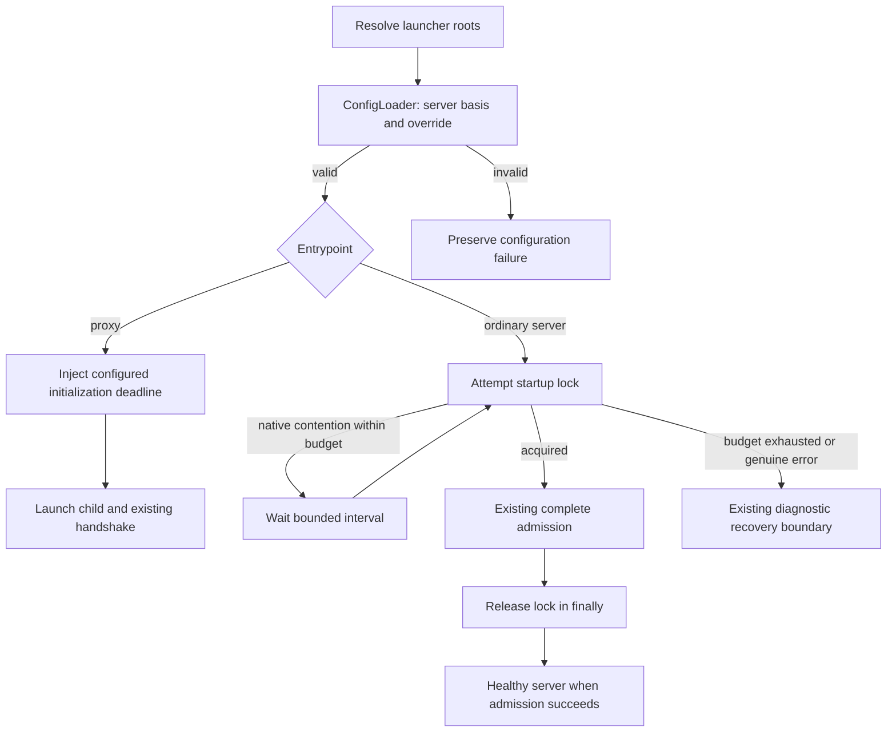

<!-- pgmcp:v1 id=design pv=1.0.0 pf=Uk1D2XWpiag1c6nn sf=WI5iXHBKVOU91bYE -->

# Issue \#520 — Bounded startup lock acquisition

**Status:** REVIEW REQUESTED  
**Version:** 1.0  
**Last Updated:** 2026-10-18

## Purpose

Specify the smallest correction for concurrent normal startup, using the approved ConfigLoader source and measured timing budgets.

## Scope In

Required composed server policy, normal-start lock retry, native error classification, proxy deadline injection, truthful recovery diagnosis, proportional behavior coverage and setup migration.

## Scope Out

Shared server/HTTP transport, reader/writer-lock redesign, activation retries, arbitrary bootstrap retry, background recovery, runtime hot reload of startup policy, release/deployment and unrelated synchronization or checker work.

## Problem Statement

A temporary nonblocking lock collision currently becomes a persistent recovery-only server. Normal startup must wait within a configured budget without weakening template activation and source admission integrity.

## Functional Requirements

- Start independently connected servers against one root; an available lock proceeds immediately, and transient native contention retries within30seconds at0.25second intervals.
- Read required defaults/server.yaml and optional root server.yaml only through the existing ConfigLoader, before acquiring the startup lock.
- Supply60seconds as the configured proxy initialization timeout; require an adequately larger outer harness startup window.
- Distinguish native lock contention from access/IO/programmer failures and preserve original diagnostic causes.
- After exhausted waiting, retain the existing limited recovery surface with an explicit timeout diagnosis and no automatic background re-admission.
- Keep direct --init and --upgrade command dispatch usable without requiring the new runtime policy first.

## Nonfunctional Requirements

- Use current OS lock primitives, stable lock-file identity, stdio/proxy ownership, generic composition, frozen Pydantic models and existing error/presentation boundaries.
- No second YAML reader/policy source, hidden timing fallback, new dependency, compatibility bridge or general retry framework.
- Adapt durable existing behavior tests; no content/syntax assertions, old-startup-preservation tests or permanent research diagnostic suite.

## Constraints

- Research1.0 and independent QA GO dd4d1465b4f690ebf0217bc4c6e091f8e215e7dd govern the design.
- Research measures feasibility rather than a worst-case latency guarantee. OS IO and arbitrary process scheduling are not preemptively bounded by the retry loop.
- Launcher settings keep root/logging responsibility; the new timing policy is not added to Settings.from_env/PGMCP_CONFIG_PATH.
- Startup-policy edits require a complete proxy/child relaunch; restart_server replaces the child and cannot apply a changed proxy deadline.

## Options

### 1. Bounded acquisition in the existing lock service

Keep acquire()/hold() as single-attempt command operations; add one explicit bounded-acquisition operation for normal bootstrap. Read all new policy through ConfigLoader.

**Pros:**

- Preserves ownership and activation semantics.
- Contains timing and native classification near the OS lock.
- Uses existing composition/injection seams.

**Cons:**

- Requires a new required config basis and explicit proxy deadline injection.

### 2. Retry complete CLI bootstrap

Reconstruct the server repeatedly after any startup rejection.

**Pros:**

- Can be expressed at one outer call boundary.

**Cons:**

- Repeats unrelated admission work and risks treating invalid configuration as temporary.
- Does not accurately delimit lock ownership or the retry cause.

### 3. Recover dynamically or share one server

Re-admit a running recovery server or multiplex clients onto a shared service.

**Pros:**

- Could avoid a later explicit restart after an arbitrarily long collision.

**Cons:**

- Adds catalog/lifecycle/session responsibilities outside the approved strategy.

## Decision

Select bounded acquisition in UpgradeLock, invoked only by normal bootstrap. Use one early composed ServerConfig for startup policy; independently launched proxy and child read it through the same loader contract. Keep current activation exclusion and recovery composition.

## Rationale

This removes the demonstrated immediate-busy-to-permanent-recovery path inside the selected budget. It changes no normal tool execution or shared-template integrity rule and avoids retrying side effects or building new lifecycle architecture.

## Production Design

### Ownership and existing seams

| Owner | Responsibility / change |
| --- | --- |
| New pure config model in mcp_server/config/schemas/server_config.py | Frozen, closed server-policy values and combination constraints; no paths, Settings, IO or loader dependency. |
| ConfigLoader.load_server_config() | One public typed read through existing _load_workspace(ServerConfig, "server.yaml"); required complete basis plus optional override. No alternate path parameter or fallback source for this policy. |
| ServerBootstrapper.bootstrap_target() | Preserve its public constructor/method boundary. Resolve its existing roots, construct the existing template-contract reader/config loader without reading the suite, load server policy, acquire with the configured wait, then execute existing admission and release in finally. Reuse that ConfigLoader for subsequent reads. |
| UpgradeLock | Own native acquisition, stable stream ownership, bounded acquisition and release. Receive primitive timing values and injectable clock/sleep dependencies; discover no configuration. |
| Proxy main() | Resolve launcher roots using Settings, load ServerConfig through ConfigLoader and pass its deadline to MCPProxy. Keep configuration IO at this composition entrypoint. |
| Existing CLI/recovery presenters | Preserve captured diagnostics and generic projection. Neutralize the existing unconditional external-source-repair heading; do not add per-code presenter branches. |

### Order and bootstrap independence

Constructing TemplateContractLoader currently only resolves/stores its root and reference-edge state. ConfigLoader construction does not load declarations. Thus bootstrap can create these existing dependencies and read only server policy before acquiring the lock. Actual schema/template/catalog reads remain inside the original admission window.

The pure new schema must not import ConfigLoader or Settings; ConfigLoader already imports GitHubSettings from settings.py, so Settings must not gain a module-level reverse loader dependency.

Normal CLI dispatch retains --version, --init and --upgrade branches before ordinary bootstrap. --init copies the registered config assets and may perform current renewal initialization without server-policy admission. --upgrade remains the existing template-renewal command, not a new general configuration installer. An existing owner installs/repairs the new config basis explicitly; document that --upgrade does not automatically create server.yaml.

### Native acquisition and lock-file initialization

Keep opening the stable lock path with a+b, position at zero and lock the same region. Remove the pre-acquisition dummy-byte write/flush: Windows byte-range locking supports a range beyond EOF, while POSIX flock is independent of file length. An empty stable lock file therefore suffices and avoids a second process failing while writing a byte already locked by the first. Never truncate, unlink, replace or steal an owned lock file.

Only the actual nonblocking native acquisition call classifies contention. On Windows, EACCES from msvcrt.locking(..., LK_NBLCK,1) is contention. On the existing POSIX flock path, EAGAIN/EWOULDBLOCK indicates a conflicting nonblocking lock; retain platform-native causes. Open/mkdir/seek and other native failures are IO failures, never a retry based merely on PermissionError type. Reacquisition on the same already-owned UpgradeLock instance is misuse and must not enter a waiting loop.

Keep acquire() and hold() as immediate operations for activation/renewal. Add acquire_with_wait() solely for ordinary startup. It attempts immediately, uses a monotonic deadline, retries only the explicitly classified native-contention outcome, sleeps at most the smaller of the interval and remaining budget, and performs no additional attempt once the budget is exhausted. It never holds an acquired OS lock during retry sleep. Failed attempts close their streams; success is released once by the existing bootstrap finally. Preserve the primary exception if cleanup also fails.

## Test Design

### Focused durable behavior coverage

| Existing family | Proof obligation |
| --- | --- |
| unit/config/test_loader.py / test_loader_behaviors.py | Public server-config read inherits basis, applies nested override and rejects missing/invalid policy. Reuse composition/schema error cases rather than duplicating all generic merge tests. Verify an unrelated reader is not invoked during this read. |
| Existing lock/startup cases in integration/test_target_startup.py and test_template_activation.py | Adapt immediate-startup exclusion to release-before-deadline success and exhausted-budget failure. Use injected monotonic/sleep for deterministic budget edges, public lock methods and actual process signaling for real exclusion; avoid30second sleeps in unit evidence. |
| Existing native acquisition boundary | Exercise actual platform acquisition with a fresh empty lock file and another process holding the same region; prove exclusion/release without asserting file contents. Inject failures through public stdlib open/native locking seams to distinguish same-errno IO from actual contention, invalid descriptor and already-owned misuse. No OS-version matrix or private-method assertions. |
| core/test_proxy.py and integration/test_target_startup.py | Inject deadline in shared ProxyHarness; retain silent-child timeout, restart and lifecycle cases. Add/extend one durable3-client real startup scenario against an isolated copied config tree; observe49-tool/healthy outcome through public MCP, not sleeps or marker existence alone. Use explicit fixture budgets and adequate client windows. Under subprocess coverage/load a functional3-client probe may need larger fixture budgets, clearly labeled as functional evidence rather than a30/60second guarantee. Keep deterministic limit controls and a focused non-instrumented30/60second acceptance observation separate; never silently relax production defaults or report an incomplete run as passing. |
| unit/test_server.py / health cases | Preserve original cause/params and two-tool limited admission after exhaustion. Assert factual timeout/path/attempt fields and original cause delivery through the public response; avoid whole-text snapshots or a negative test whose sole purpose is rejecting old wording. |
| Existing installed startup/CLI setup | Prove fresh init receives the new basis; direct renewal remains callable without normal-start policy admission and cannot weaken unresolved recovery protection. Adapt only fixtures that actually construct a startup root or direct proxy. |

Prefer extending valuable existing cases and shared fixtures; consolidate overlap so the suite gains only distinct corrected behaviors/invariants. No legacy fail-fast-startup compatibility assertions, generated-source string tests, new permanent diagnostics module or broad implementation-time test runs. Ordinary healthy direct bootstrap signatures remain unchanged, limiting fixture blast radius.

## Contracts

### Configuration schema and public read

The following declarations define field shape; validator bodies and implementation are intentionally omitted.

```python
PositiveSeconds = Annotated[
    float, Field(strict=True, gt=0, allow_inf_nan=False)
]

class StartupLockConfig(BaseModel):
    model_config = ConfigDict(frozen=True, extra="forbid", strict=True)
    max_wait_seconds: PositiveSeconds
    retry_interval_seconds: PositiveSeconds

class ProxyConfig(BaseModel):
    model_config = ConfigDict(frozen=True, extra="forbid", strict=True)
    initialization_timeout_seconds: PositiveSeconds

class ServerConfig(BaseModel):
    model_config = ConfigDict(frozen=True, extra="forbid", strict=True)
    version: Literal["1.0.0"]
    startup_lock: StartupLockConfig
    proxy: ProxyConfig

def load_server_config(self) -> ServerConfig: ...
```

Every field is required; no timing default is duplicated in the model. JSON/YAML numeric30 and0.25 are accepted, while booleans, numeric strings, nonfinite values and nonpositive values are rejected. Model validators require retry_interval_seconds <= max_wait_seconds and proxy.initialization_timeout_seconds > startup_lock.max_wait_seconds. These constraints reject impossible basic combinations without claiming a scheduling guarantee.

The selected basis is:

```yaml
version: "1.0.0"
startup_lock:
  max_wait_seconds: 30
  retry_interval_seconds: 0.25
proxy:
  initialization_timeout_seconds: 60
```

The ordinary optional workspace override may change individual nested fields; the complete basis and composed result must each validate. Missing required fields, duplicate/unknown keys, invalid basis/override, and deletion of a required field remain standard ConfigLoader/Pydantic errors. No new merge or deletion logic.

### Lock API and proxy constructor

```python
class UpgradeLock:
    def __init__(
        self,
        path: Path,
        *,
        monotonic: Callable[[], float] = time.monotonic,
        sleep: Callable[[float], None] = time.sleep,
    ) -> None: ...
    def acquire(self) -> None: ...
    def acquire_with_wait(
        self, *, max_wait_seconds: float, retry_interval_seconds: float
    ) -> None: ...
    def release(self) -> None: ...

class MCPProxy:
    def __init__(
        self,
        *,
        initialization_timeout_seconds: float,
        process_factory: ProcessFactory = launch_server,
        event_presenter: EventPresenter = present_proxy_event,
    ) -> None: ...
```

The wait operation consumes finite positive validated timing values and enforces its public preconditions without loading config. Clock/sleep are operational injection seams, not policy defaults. acquire/hold remain single-attempt; only acquire_with_wait has startup waiting. Removing MCPProxy's implicit30second policy makes direct construction explicit. The current direct consumers are its main entrypoint, ProxyHarness in core/test_proxy.py and the installed functional probe's already-explicit90second constructor. Adapt the shared harness once rather than editing individual proxy scenarios.

### Stable diagnosis contract

Reuse MCPError(code="ERR_CONFIG") and existing StartupDiagnostic/HealthCheckOutput; add no per-error exception/DTO hierarchy.

| Outcome | message / structured params | Original cause |
| --- | --- | --- |
| Native contention, immediate API | template_upgrade_locked; reason=contention, lock_path | Native locking OSError |
| Already owned instance | template_upgrade_locked; reason=already_owned, lock_path | Preserve existing misuse diagnosis; no retry |
| Wait exhausted | template_upgrade_lock_timeout; lock_path, max_wait_seconds, retry_interval_seconds, elapsed_seconds, attempts | Last classified contention error, retaining its native cause |
| Non-contention acquisition IO | template_upgrade_lock_io_error; lock_path, operation identifying the failed acquisition stage | Original OSError, including errno/native details |
| Invalid/missing early config | Existing ConfigError with source path/schema diagnosis | Existing loader cause |

The waiter selects only reason=contention, not arbitrary same-message or OSError errors. Activation's existing upgrade_busy mapping remains limited to a genuinely occupied lock. Correcting misclassified IO must not add retries to that command.

StartupRecoveryPresenter changes its health failure heading to a neutral 'Server admission failed.' and keeps complete generic JSON diagnostic projection. It must not tell every caller to edit configuration, render new error-code-specific advice, load a rejected presentation.yaml, or compose recovery prose in the lock service. The timeout key and factual params make temporary-contention exhaustion distinguishable; active reference/setup docs explain later explicit restart versus actual source repair. Existing health/restart schemas, schema availability, cache independence and the two-tool recovery surface are preserved.

## Flow



CLI --init/--upgrade dispatch precedes the ordinary-server branch. The proxy samples policy when launched; the child independently uses the same ConfigLoader contract. Applying a changed coordinated startup policy requires full proxy/child relaunch. No runtime hot-reload or alternate environment snapshot of timing policy is added.

## State and Failures

### Admission and time budgets

Waiting is still pre-admission: ordinary tools are not exposed until the unchanged complete bootstrap succeeds. No new workflow state, mutable retry record or lock-owner registry is persisted. The lock file remains an OS synchronization endpoint, not an owner/status database.

The lock deadline begins with bounded acquisition, while the proxy's initialize timer begins when forwarding initialize. Proxy setup/imports and outer client startup have their own elapsed time. The60second proxy policy leaves30seconds beyond the maximum configured lock wait; remaining admission/handshake can still exceed it under unbounded load. A documented75second outer startup window is a setup recommendation, not a pgmcp-enforced client setting.

If waiting expires, capture the last contention cause and factual elapsed/attempt values through the existing CLI recovery boundary. The recovery server remains unhealthy and requires an explicit later restart after contention ends; no silent background retry is introduced.

If proxy main cannot load/validate required server policy, do not launch a child with a fallback deadline. Surface the existing source diagnosis on stderr/terminal boundary; an MCP endpoint may not exist. Direct server launch can still compose existing recovery after an early ConfigError. This distinction follows which entrypoint can be initialized; it does not promise health tools before valid proxy configuration.

### CLI install/renewal and policy changes

A fresh --init does not require an already-existing basis; copying current assets installs it. Direct --upgrade bypasses normal startup-policy admission and retains existing template renewal/recovery, but does not become a server-config installer. Existing-workspace configuration migration is explicit. A changed proxy deadline takes effect only after relaunching the proxy, so restart_server alone is insufficient to apply coordinated startup-policy edits. No active harness configuration is changed by this issue.

## Preservation

Keep the entire protected source-admission window, unresolved recovery refusal, stable OS lock and activation command semantics. Keep healthy tool DTOs/catalog, limited recovery tool names, existing stdio sessions/protocol/structured output, proxy request/generation/cancellation ownership and all workflow/state mutations unchanged. Preserve original causes and diagnostic serialization; narrow falsely-busy IO classification without replacing tracebacks with prose.

## Transition and Cleanup

Add the required server basis under the existing registered .pgmcp/config asset tree. No release_manifest or builder logic change. Existing workspaces explicitly install the basis and may author the optional override before normal launch; root resolution/logging launcher settings remain as currently supported. New timing fields are not accepted through PGMCP_CONFIG_PATH. Remove the implicit proxy30second timing default and the lock's unnecessary byte write; do not leave compatibility fallbacks. Source activation/harness restart remains an explicit later operation.

## Validation

### Remove the evidenced transient-busy startup defect.

**Method:** Focused deterministic lock controls plus a real isolated3-client proxy/MCP scenario on the selected Python3.15/MCP2.3 baseline.

**Expected Result:** All clients report healthy and expose the complete normal catalog after contention clears within configured budgets; no source mutation is required.

### Preserve failure discrimination and integrity.

**Method:** Focused native busy/IO/timeout, activation exclusion and unresolved-record cases.

**Expected Result:** Only true contention waits; exhausted budget and real defects remain unadmitted with original diagnostic facts; no lock deletion or recovery mutation.

### One early policy source and correct lifecycle boundary.

**Method:** Public ConfigLoader tests, missing/invalid basis, CLI init/renewal and configured proxy-entrypoint tests.

**Expected Result:** Defaults/override work through the existing loader, proxy receives its explicit configured deadline, no fallback policy or inability to initialize fresh roots.

### Proportional implementation and final acceptance.

**Method:** During implementation use only affected tests/checks. Validation owns the existing workflow-required workspace/full-suite run on the selected runtime; reuse fresh passing evidence where valid.

**Expected Result:** Configured required gates pass without new ignores, compatibility matrix or broad unrelated repairs.

## Risks

### A synchronous OS call or arbitrary load can exceed nominal startup estimates.

Keep configured proxy/harness bounds, truthful timeout diagnosis and the measured feasibility limits; do not claim a latency guarantee.

### Policy edits can give an old proxy and a newly restarted child different timing snapshots.

Define coordinated startup-policy changes as requiring full proxy/child relaunch and document that restart_server alone does not apply a new proxy deadline.

### An early required basis could block fresh setup or renewal.

Keep direct CLI init/upgrade dispatch outside ordinary startup-policy admission; install the basis through existing assets and explicit workspace migration.

## Planning Consequences

Planning must allocate a bounded change for the pure model/ConfigLoader/basis and entrypoint injection, and one for native acquisition/recovery behavior with its focused proofs. These are responsibility boundaries, not a cycle sequence. Preserve narrow implementation checks, Validation-owned broad acceptance and independent QA at phase boundaries. No need to change workflow/enforcement/agent instructions or release machinery.

## Sources

- [Approved Research and native documentation](<research.md>)
- [Configuration reader](<../../../mcp_server/config/loader.py>)
- [Launcher settings](<../../../mcp_server/config/settings.py>)
- [Source admission](<../../../mcp_server/bootstrap.py>)
- [Existing lock and activation](<../../../mcp_server/services/template_activation.py>)
- [CLI dispatch](<../../../mcp_server/cli.py>)
- [Proxy](<../../../mcp_server/core/proxy.py>)
- [Recovery presenter](<../../../mcp_server/presenters/startup_recovery_presenter.py>)
- [Current proxy operational contract](<../../reference/proxy_restart.md>)
- [Architecture contract](<../../coding_standards/ARCHITECTURE_PRINCIPLES.md>)

## Version History

| Version | Date | Author | Changes |
| --- | --- | --- | --- |
| 1.0 | 2026-10-18 | @imp designer | Specify one composed startup policy, bounded acquisition/native diagnosis and proxy/CLI integration with proportional behavioral verification. |
