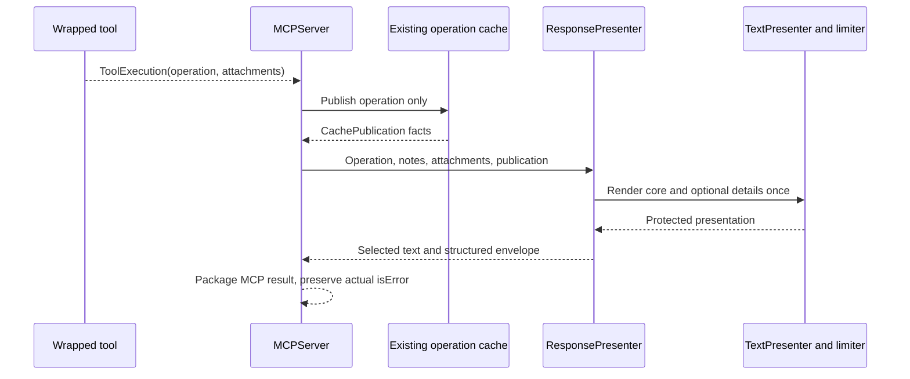

<!-- pgmcp:v1 id=design pv=1.0.0 pf=Uk1D2XWpiag1c6nn sf=WI5iXHBKVOU91bYE -->

# Issue \#529 — Configurable response profiles and protected presentation

**Status:** PROPOSED — Design complete for independent review; not implemented  
**Version:** 0.2  
**Last Updated:** 2026-10-19

## Purpose

Define a small presentation-boundary refactor that preserves instructions and complete normal output through explicit per-process profiles, without harness-specific tool code.

## Scope In

Presentation configuration and process-local selection; one public structured envelope; protected rendering and budgets; normal and emergency MCP projection; configuration-independent startup recovery; direct affected tests and current documentation.

## Scope Out

No tool/manager/adapter behavior changes, client fingerprinting, per-call profile controls, new loader/cache reader, cache ownership expansion, harness certification matrix or compatibility path. #528 retains normal-registration output-model metadata repair and any tool-specific schema refinement. No production implementation in this phase.

## Prerequisites

- Approved Strategy in Research v1.3, including the owner's explicit startup-recovery decision.
- Independent Research content GO at 3d919b27172b016eaceb278f81060a80373d6a9f; workflow precondition resolved by the approved registration correction in 9bdad1170f1cd99cdd430ac4b658cfe3b1032933.
- Normal Research → Design transition completed through transition_phase; existing state identity and history retained.

## Problem Statement

The current server publishes independently rendered text, raw structured operation data and schema attachments. Clients can expose different subsets to agents, losing instructions despite a valid DTO. A hard final-text ceiling can also cut required guidance. The target must route the same authoritative presentation according to an explicit profile, preserve complete normal data, and make a cache failure truthful without corrupting the response or replacing the actual operation outcome.

## Functional Requirements

- Publish the full rendered short explanation and mandatory instructions in the selected presentation channel(s). There is no off setting.
- Select presentation_channel=text/structured/both, data_channel=text/structured and data_delivery=inline/resource independently for one server process.
- Preserve full operation data and attachments on normal routes; resource delivery points only to successfully published operation data and keeps attachments direct.
- Preserve actual operation success/isError after publication failure; protect mandatory failure/truncation notices and bound only emergency diagnostic details.
- Use a common public structured envelope; advertise an output schema only when a structured projection is selected, including valid delivery-failure variants.
- Keep startup health/restart recovery independent of rejected configuration, with the owner-approved full dual-channel exception.

## Nonfunctional Requirements

- Reuse ConfigLoader defaults/workspace composition, Settings, bootstrap, existing presenters, limiter, operation cache and MCP converter boundaries.
- Keep internal operation DTOs, ToolExecution, notes, adapters, domain behavior, cache reading/paging and filesystem/git operations unchanged.
- Use frozen, extra-forbid presentation/config value models and explicit startup validation. No hidden profile ID in code.
- Make clean changes at the public/config/presenter contracts. Adapt valuable existing behavior tests instead of adding old/new format or client-version coverage.
- Distinguish UTF-8 detail/presentation bytes from total wire bytes, model tokens, memory use and billed cost; no universal ceiling is promised.

## Constraints

- Architecture Principles §§2–4 and 15 govern authoritative facts, config-first validation, failure handling and presentation ownership.
- Configured wording remains in presentation.yaml; profile mechanics must not introduce tool-name or harness-name branches.
- Design defines contracts and invariants, not method bodies, patch sequences or implementation cycles.
- The branch keeps its original chore/529-establish-client-output-contract name; authoritative runtime workflow is refactor.

## Options

### 1. Reuse existing presentation composition

Extend the current pure config models, TextPresenter, TextBudgetLimiter, ResponsePresenter and PresentedOutput. Bootstrap resolves one immutable profile; MCPServer packages the completed projection.

**Pros:**

- One rendering source and one existing loader.
- No domain/profile dependency or additional response framework.

**Cons:**

- Presenter return contracts and their direct tests change together.

### 2. Route output separately in each tool or adapter

Rejected: select client/channel behavior in individual executions.

**Cons:**

- Duplicates routing policy and violates the approved presentation boundary.

### 3. Preserve bare DTO plus a parallel compatibility format

Rejected: dual old/new external shapes or unconditional text copies regardless of selection.

**Cons:**

- Contradicts the owner-approved clean break and explicit channel selection.

## Decision

Extend the existing presentation composition. Resolve one immutable capability profile at bootstrap, render protected presentation once, then project presentation/data/attachments into text and/or the common structured envelope. Keep a distinct fixed startup-recovery mode within the existing recovery presenter, as explicitly approved.

## Rationale

The current source already separates operation facts, schema attachments, text rendering, resource formatting and MCP serialization. The change belongs at those seams. A model/harness classifier or second serializer/presenter architecture would add ownership and maintenance without establishing downstream agent behavior.

## Production Design

| Responsibility | Existing owner and target contract |
|---|---|
| Shared definitions and wording | PresentationConfig, defaults/presentation.yaml and the existing workspace override; no new files for profiles |
| Process-local selection | ServerSettings.response_profile plus Settings.from_env; bootstrap resolves and injects one effective frozen profile |
| Main explanation, phase instructions and notes | TextPresenter, rendered once from current operation/config/NoteContext inputs |
| Optional collection/detail rendering and safe cuts | Existing collection renderer and TextBudgetLimiter; protected material never enters an unqualified final prefix cut |
| Data route, attachment representation and envelope | ResponsePresenter and frozen presentation-output DTOs |
| MCP content/structuredContent/isError and catalog schema | MCPServer and existing converter; mechanically transfer presenter output, never reconstruct data from Markdown |
| Raw operation publication and paging | Existing ResponseCacheManager and CachedResponseResource; normal representation, URI/window contract and raw DTO ownership retained; publication explicitly reports serialization failure |
| Config-independent recovery | Existing StartupRecoveryPresenter composed by cli.py; fixed full dual-channel projection without consulting rejected configuration |

The presentation return-contract change is intentional: IPresenter remains the narrow presentation dependency of MCPServer; tools, managers, adapters and operation models receive no new dependencies. Bootstrap passes concrete values, not a ConfigLoader or whole Settings object, into presenters.

## Test Design

Adapt existing tests at public seams; do not add a new harness suite. Representative contract matrix, not a full Cartesian multiplication of every DTO:
| Existing seam | Intended behavior |
|---|---|
| unit/config/test_presentation_config.py and test_settings.py | Required profile/default, invalid selectors/combinations/budgets, explicit override precedence and frozen resolved values |
| unit/presenters/test_text_budget_limiter.py and test_text_presenter_composition.py | Core preservation, optional-detail omission, tiny budgets, UTF-8 and fence closure, complete phase and note guidance |
| integration/test_execution_presentation_v3.py | Three shipped profiles plus cross-channel edge cases; real operation/cache behavior and bounded emergency diagnostics |
| integration/test_tool_attachment_transport.py and test_pipeline_e2e.py | Full selected data/attachment output, actual MCP SDK/schema acceptance, domain/input errors and truthful isError |
| integration/test_target_startup.py | Two instances sharing config with distinct selectors; configuration rejection reaches existing full recovery route |

Prefer parametrizing useful existing cases and deleting obsolete bare-DTO/final-hard-ceiling assertions. Keep no tests whose only purpose is forbidding the old implementation. Test input-derived markers and values instead of fixed production wording. Direct protocol and DTO tests should prove meaningful invariants, not repeat field definitions. No client names, model versions, dependency surveillance, permanent probe scripts or source-string assertions.

Targeted implementation runs prove the changed slice; reserve any workflow-required wider verification for Validation. Design itself runs document checks only and makes no implementation-pass claim.

## Contracts

### Configuration and process selection

Presentation configuration version becomes 2.0.0; no old-format translator or alias is added. The existing loader derives the expected version from the schema, so no file-specific loader branch is required.

```yaml
version: 2.0.0
global:
  default_response_profile: structured_inline
  max_text_response_bytes: 8000
  max_cache_failure_detail_bytes: 8000
  cache_read_budget_chars: 6000
  # Existing wording/formatting declarations remain here.
response_profiles:
  structured_inline:
    presentation_channel: both
    data_channel: structured
    data_delivery: inline
  structured_resource:
    presentation_channel: both
    data_channel: structured
    data_delivery: resource
  text_inline:
    presentation_channel: text
    data_channel: text
    data_delivery: inline
# Existing tools declarations remain shared.
```

ResponseProfileConfig is frozen/extra-forbid. Its three channel/delivery fields are required literals. It may override the same three positive integer budgets from global; omitted overrides inherit them. An empty profile map, unknown default, invalid literal, unknown field or non-positive budget is a startup configuration error. Mapping keys identify profiles; profiles have no order semantics. The two 8000-byte defaults retain the existing presentation magnitude; they do not bound bulk inline data or mandatory material.

ServerSettings.response_profile is an optional nonempty string. An explicitly supplied PGMCP_RESPONSE_PROFILE overrides the existing launcher-settings value; absent selection uses global.default_response_profile. An explicitly empty or unknown selector is an error, not an absent value. Resolution happens once after normal config loading; the effective profile contains all resolved numeric values and is immutable. A changed launch selector requires reconnect/relaunch. The proxy already inherits process environment on child restart; do not add profile state there. Definition/schema changes require server reload and tool-catalog refresh. No mid-call reload, per-call selector or shared active-profile field is introduced.

cache_read_budget_chars remains the threshold for showing existing pagination advice. Actual offset/limit resource reads remain unchanged.

### Protected rendering and text budgets

Extend the text presentation return contract with a small frozen RenderedPresentation value: core: str and details: str. Keep it with the existing presentation-output DTOs. ITextPresenter.present_text returns this value rather than a final destructively limited string; the direct consumers are ResponsePresenter and its existing test seams. present_notes retains its current string contract.

Core contains the complete configured success/failure template, enum-state explanation, applicable next instructions and all rendered notes. This conservatively protects phase_instructions/handover_template already embedded in get_work_context's main template and recovery/suggestion guidance in notes. Do not parse Markdown, inspect tool names or maintain a second list of mandatory instructions. Additional configured collections are optional details and retain their existing max_items behavior. Config authors must keep short explanations in their template; an unusually large template scalar remains protected rather than being silently classified as disposable diagnostics.

TextBudgetLimiter accepts protected core and optional details separately and returns text plus a details_truncated fact. Its byte allowance applies only to what may be cut: account for core, separators and required notices before admitting optional details; if core consumes/exceeds max_text_response_bytes, retain core and applicable omission notices and omit optional details. The existing validation that rejects budgets too small for a fixed tail is replaced by positive-budget validation and protected-overrun behavior. Normal field/item formatting is unchanged. The limiter never cuts the combined final response, inline operation data or attachments.

Cache reference and necessary pagination guidance are protected delivery notices and use the existing configured text. They are added after successful publication, never inferred from a DTO run_id when publication failed. Failure and truncation wording remains external presentation configuration. Both channels use the same rendered value, not separate render passes.

### Public envelope and data representation

The public structured shape is an application-defined object, not a mutation of the internal operation DTO. Frozen value-model contracts, without implementation bodies:

```python
class InlineOperation(BaseModel):
    delivery: Literal["inline"]
    operation: JsonObject

class ResourceOperation(BaseModel):
    delivery: Literal["resource"]
    uri: str
    size_chars: int | None

class DeliveryFailure(BaseModel):
    code: Literal["cache_publication_failed", "operation_serialization_failed"]
    details_truncated: bool

class PublicToolResponse(BaseModel):
    success: bool
    presentation: str | None
    data: InlineOperation | ResourceOperation | None
    attachments: tuple[PresentationResource, ...]
    delivery_error: DeliveryFailure | None
```

All five outer fields are present; these models are frozen, extra-forbid and strictly validated. JsonObject uses the existing JSON value contract; it is not derived from rendered text. Inline operation uses the same actual operation JSON-mode serialization with aliases as today's structured DTO. Attachment fields reuse PresentationResource: uri, mime_type, content. The existing SchemaResourcePresenter continues to own URI/MIME/content conversion; it does not inspect operations.

presentation is populated only when the presentation channel includes structured. data and attachments are populated only when data_channel=structured; otherwise data is null and attachments is empty. success always comes from the actual operation outcome, independently of where its bulk fields are delivered. delivery_error is null normally and describes the emergency exception when applicable. These structural metadata are not a second presentation rendering.

For data_channel=text, include one complete serialized object containing data and attachments in a distinct JSON text segment after any selected presentation. It has the same data/attachment representation as above. Do not run the presentation limiter over that segment. The text surrounding it is ordinary prose, but the complete designated data segment remains parseable JSON on normal routes. Attachments are present directly even in resource mode: the resource points only to the operation. Do not emit unconditional additional embedded or structured copies when their channel is unselected.

PresentedOutput becomes a frozen projection with text: str | None and structured_content: JsonObject | None; remove its unconditional resources transport field. ResponsePresenter incorporates the resource presenter's returned attachment values into the selected data representation. MCPServer emits a TextContent block only when text is present, transfers structured_content directly and uses the real operation success for isError. An entirely structured normal result can therefore have content=[].

Illustrative structured_inline result (presentation_channel=both):
```json
{
  "success": true,
  "presentation": "Planning updated. Read the refreshed work context.",
  "data": {"delivery": "inline", "operation": {"success": true, "total_cycles": 3}},
  "attachments": [],
  "delivery_error": null
}
```
The same presentation string is in content; the operation data is not duplicated into text by that profile.

MCPServer requires an injected IPresenter for healthy and recovery assembly; remove the current presenter=None/str(dto) bypass rather than providing a hidden profile. Existing constructor tests/helpers supply an explicit presenter. RenewalPresenter's terminal installation/release text and raw proxy events are independent entrypoint projections and retain their current contracts.

### Channel combinations and output schemas

Normal presentation routing:
| presentation_channel | Text presentation | Structured presentation |
|---|---|---|
| text | Full rendered value | null |
| structured | None | Full rendered value |
| both | Full rendered value | Same full rendered value |

Normal data routing:
| data_channel | data_delivery | Selected data representation |
|---|---|---|
| structured | inline | Full operation and attachments in structured envelope |
| structured | resource | Published operation URI/size and direct attachments in structured envelope |
| text | inline | Full operation and attachments in complete JSON text segment |
| text | resource | Published operation URI/size and direct attachments in complete JSON text segment |

All twelve combinations are admitted; resource profiles require an installation whose agent can actually read MCP resources. The server cannot certify that client capability from its name. Definitions may add combinations without new Python branches per profile ID.

IPresenter adds output_schema() -> JsonObject | None. ResponsePresenter derives the common public envelope schema from the same frozen response models and resolved profile used by present(). The schema admits the actual normal projection and cache-failure projection; literal/null restrictions reflect which fields that profile selects. No handwritten per-tool field inventory or per-client schema exists. If presentation OR data selects structured, advertise this envelope schema and return structured content, including errors normalized to an operation DTO. If both exclusively select text, omit outputSchema and structuredContent, including during the text emergency.

The common schema deliberately types operation as a JSON object, without claiming a specific tool's success DTO or error union. This is sufficient for the approved general envelope and can be published without repairing decorator metadata. #528 remains responsible for recovering output-model metadata through normal registration and any justified per-tool refinement. Do not add that repair, duplicate a tool registry or advertise a success-only DTO as this envelope.

Schemas remain fixed for the connected catalog lifetime. Runtime cache failure uses an already-admitted delivery_error alternative, not a new schema or changed tool registration.

### Publication failure and bounded emergency details

| Condition | Outcome and delivery |
|---|---|
| Inline profile, cache publication succeeds | Complete operation and attachments remain inline; cache receipt may supply normal direct reading guidance. |
| Inline profile, cache publication fails but normal inline serialization is available | Keep full inline operation and attachments. Protect the configured cache-unavailable notice; do not discard already available inline data or add a redundant full JSON fallback. |
| Resource profile, publication succeeds | Supply real URI/size from CachePublication and direct attachments; no inline operation duplicate. |
| Resource profile, publication fails or publisher is absent | No usable resource reference. Return emergency text, retain selected structured presentation, and mark delivery_error with unavailable data; distinguish serialization failure as specified below. |
| Required profile or definitions invalid | Existing recognized startup-rejection/recovery path; never choose another normal profile silently. |

A resource failure's mandatory core comprises actual operation outcome, rendered explanation/instructions/notes, cache-failure notice and any diagnostic-truncation notice. All remain complete even if they exceed max_text_response_bytes or the diagnostic allowance. Emergency text is emitted even for a normally structured-only presentation profile; this is the explicit owner-approved exception. Keep the selected structured presentation as well. A structured data projection has data=null, direct complete attachments and delivery_error; for data_channel=text, retain direct attachments in a complete JSON text segment with unavailable data. The structured envelope, when selected, independently retains delivery_error even when data_channel=text.

Append at most max_cache_failure_detail_bytes of diagnostic text, including its excerpt label/formatting closure; this allowance does not contain the mandatory core or direct attachments. UTF-8 cuts retain valid Unicode. Label JSON-derived fragments as potentially incomplete diagnostic text, not complete JSON or an application/json resource. Never slice the enclosing serialized MCP/JSON-RPC message. No unavailable-looking-valid URI, completeness claim or claim of full logs/files without established storage.

Bound only the diagnostic excerpt. When inline serialization already succeeded, use available facts; do not reconstruct a DTO from presentation. When serialization itself failed, do not retry the same full serializer or dump an unbounded arbitrary object representation. Preserve the actual serialization diagnosis at the existing error boundary and use available scalar/native diagnostic facts for the excerpt; if unavailable, say so through configured failure wording. An excerpt-generation problem cannot turn a successful completed mutation into a reported operation failure. The targeted serializer failure-contract correction is defined below; no new exception framework, replacement cache or generic serializer framework is introduced.

This design specifies output bounds, not streaming/memory/time guarantees for arbitrary payload objects. Operation/cache facts remain authoritative; a delivery error is distinct from operation failure.

### Serialization completeness and original-error ownership

QA identified a concrete existing counterexample: serialize_cached_response catches a native serialization exception and returns replacement SerializationError JSON; ResponseCacheManager.put then reports success and CachedResponseResource.read may return that replacement. Such a receipt does not establish complete operation availability.

Close this within the existing boundaries, without a second cache or serializer framework:

| Boundary | Required contract |
|---|---|
| serialize_cached_response(dto) -> str | Return the canonical normal operation JSON, retaining current optional-null and alias policy. On failure, propagate the original exception/cause; remove the concealed replacement-JSON success path. Do not catch and turn it into a different operation. |
| ResponseCacheManager.put | Invoke canonical serialization once before accepting the entry. Serialization failure returns CachePublication(success=False, run_id=None, error_code="serialization_failed", diagnostic=capture_exception(original_exception)); no new cache entry or eviction occurs. Other publication failures retain error_code="write_failed" and the captured diagnostic. Logging/capture belongs to this existing boundary. |
| CachePublication | Extend the frozen receipt with diagnostic: ConfigErrorOutput or ExecutionErrorOutput, optionally None. This exactly matches capture_exception's existing diagnostic union; preserve its actual variant, error code, file_path where present, traceback and original exception chain. These existing diagnostic DTOs remain distinct from the actual tool operation. Success implies a real run_id, full canonical serialization and no diagnostic/error_code. Failure implies run_id=None and error_code; failed serialization is never called successful publication. Validate these combinations. |
| CachedResponseResource.read | Successful canonical JSON and window semantics stay unchanged. A subsequent serialization error propagates to the existing MCP read-resource error boundary; never return a replacement DTO under a complete-operation resource claim. No second JSON cache or read API. |
| Inline projection in ResponsePresenter | Attempt the actual operation JSON-mode projection once when inline data is needed. Catch a failure at this existing presentation boundary, retain capture_exception diagnostics and use the schema-valid operation_serialization_failed delivery variant. Do not replace actual success/isError or repeat that failed full projection. A failure of the distinct canonical cache projection does not establish failure of inline projection, or vice versa. |
| TextPresenter core rendering | Core template/instruction rendering must not depend on successful serialization of the whole DTO. Resolve the existing declared template fields from the original operation values through the existing generic formatter. Optional collection rendering remains at its existing seam. A failed full JSON projection must not prevent required guidance from being rendered. |

These are explicit error-contract corrections required by the approved truthful-delivery guarantee. They do not change the cache's operation ownership, normal JSON representation, memory policy or paging protocol. The original operation remains authoritative; CachePublication.diagnostic only supplies delivery diagnosis. This removes a hidden failure conversion rather than preserving it through a compatibility path.

Complementary cases:
| Cache result | Inline projection, when required | Delivery |
|---|---|---|
| Full operation published | Complete | Normal inline or resource route |
| Serialization failed | Complete | Inline profile retains full inline data and explicit cache-unavailable notice; resource profile uses operation_serialization_failed emergency, no URI |
| Other publication failure | Complete | Inline profile retains complete data; resource profile uses cache_publication_failed emergency |
| Either result | Inline serialization fails | Inline profile uses operation_serialization_failed emergency with actual operation outcome, selected mandatory presentation, direct attachments and data=null |
| Full operation published | Not requested by resource profile | Use the successful canonical resource without a redundant inline serialization attempt |

delivery_error.code therefore distinguishes operation_serialization_failed from cache_publication_failed. Both admit the same protected emergency layout and bounded native diagnostic excerpt. If an inline projection fails after a real resource was published, keep any configured cache guidance truthful but do not silently change the selected inline data route or claim complete inline delivery. An inline diagnostic failure is explicit even when an alternate readable resource exists. Resource fallback does not retry the failed canonical serializer. Use available original exception/native facts for the bounded excerpt; no error-prose parsing, full-object repr, or another exception/serialization framework.

Adapt the existing serialization-failure branch in integration/test_cache_fidelity_v3.py to assert failed publication/no URI and retained exception/cause, together with existing canonical fidelity cases. Extend existing publication/response cases to prove the independent inline-success and inline-failure variants and preservation of actual isError. This is focused current-behavior coverage, not tests rejecting or retaining the old fallback.

### Configuration-independent startup recovery

The owner explicitly approved this exception during Design. Existing cli.py startup-rejection handling continues to construct DegradedMCPServer with StartupRecoveryPresenter and no publisher/resources. It must not try another loader, reopen the rejected presentation file or resolve a profile from invalid configuration.

StartupRecoveryPresenter uses the same PublicToolResponse/PresentedOutput contracts but a fixed recovery projection: full recovery text and instructions in content and presentation; complete operation diagnosis inline in data; complete attachments if supplied; delivery_error=null because no resource delivery was attempted. isError still reflects the recovery operation outcome: a failed admission diagnostic is not automatically failure of the health query, and a restart receipt is not admission success.

No healthy profile budget or cache dependency applies in recovery. Full duplicated recovery text is the explicit availability choice, not compatibility with the old bare DTO. Normal healthy bootstrap restores the configured profile. Raw proxy transport/launch failures occurring before an MCP response remain in the existing proxy-event presentation route; they are not invented tool operations or given a false operation outcome.

## Flow


The active immutable profile is injected at construction; no call mutates it. Schema lookup uses that same presenter contract. Rendering wording stays configured; transport serialization adds no tool-specific explanation.

## State and Failures

No workflow state or shared active-profile state is introduced. Normal wrappers continue to normalize policy, input and developer errors with their existing DTOs and tracebacks. Those actual operations pass through the same selected profile as successes. Unknown tool requests and failures before an operation exists remain genuine transport/processing errors at their existing boundary, with original cause logged; do not invent a successful/failed operation. The specifically designed publication emergency applies only after an actual operation exists. It is not a general rewrite of every server exception path.

## Preservation

| Invariant | Target evidence |
|---|---|
| Real operation outcome, fields and aliases | Unchanged operation DTO passed to publication; normal inline payload compared with that DTO's public JSON serialization |
| Complete instructions and recovery advice | Dynamic markers before/after long required material survive selected projections and protected budget overrun |
| Attachments separate from operation cache | Existing attachment/carrier test adapted; URI/MIME/document intact in selected data channel |
| Pure cache read/window contract | Existing real resource read recovers complete operation; no new envelope cached |
| Independent concurrent server choices | Two server instances using one config root return different selected projections without shared-file mutation |
| Startup repair remains available | Isolated existing startup test exercises invalid presentation/profile configuration and fixed full recovery response |
| No fake operation failure after mutation | Successful operation plus failed publisher yields success/isError unchanged and explicit delivery_error |

## Transition and Cleanup

Apply one clean contract cutover in later implementation, including removal of the hidden canonical-serialization replacement-JSON success path: update shipped presentation config and affected focused config/test builders together; remove the old bare structured assignment and unconditional attachment transport path. Remove the old final-prefix limiter behavior and unlimited cache-failure JSON append when replaced, rather than retaining aliases or a parallel legacy presenter. Keep the current main rendering templates and note sources; no second per-tool configuration inventory. Update current setup/presentation/cache-reading references during Documentation; preserve historical issue reports except these current authoritative phase artifacts. Release/install execution and #528 implementation remain outside this Design.

## Validation

### Selected projections and advertised schema agree

**Method:** Exercise actual list_tools/call_tool SDK boundary for representative normal and normalized error outcomes, including structured-presentation/text-data cross-routing and resource emergency.

**Expected Result:** Declared profile schema validates the emitted envelope; text-only profile has neither schema nor structuredContent; no duplicated unselected presentation.

### Mandatory core always survives

**Method:** Supply long dynamic required instructions/recovery notes, optional details and multi-byte characters under a deliberately small presentation budget.

**Expected Result:** Every mandatory marker remains complete in selected presentation; only details are shortened; protected overrun is allowed and truthful notices remain.

### Complete normal output and attachments

**Method:** Compare inline operation to actual DTO serialization; for a real cached resource page through its existing reader and compare operation facts; inspect supplied schema attachment in each selected data channel.

**Expected Result:** All operation facts and attachments remain available by the promised normal route; attachments do not enter operation cache.

### Emergency response remains truthful and bounded

**Method:** Inject publisher failure and native serialization failure after successful and failed operations, including independently failing canonical-cache and inline projections, with diagnostics beyond the byte limit.

**Expected Result:** No fake URI or false completeness claim; valid MCP JSON and schema variant; actual outcome retained; bounded labelled excerpt and complete instructions/notices.

### Instance selection and recovery

**Method:** Reuse isolated startup seams with one shared config root and two process-local selectors; reject an invalid profile/config and call health/restart recovery.

**Expected Result:** Independent profile projections, no shared state writes; recovery full dual-channel response independent of rejected configuration.

## Risks

### Configured main templates may themselves contain large scalar values.

Treat the full configured explanation as protected; keep optional collections/details separate. Document that the budget is not a total-response ceiling.

**Consequence:** A large mandatory core intentionally exceeds the numeric budget.

### A client may ignore or truncate the selected channel or lack resource access.

Document per-installation profile prerequisites and retain bounded probe observations; do not infer capabilities or promise downstream behavior.

**Consequence:** Operators must choose an appropriate profile; server-only tests cannot certify all harnesses.

### Normal public schema changes interact with \#528.

Use the common profile envelope schema here; keep decorator output-model propagation and tool-specific refinement in #528.

**Consequence:** No claim that the generic operation object schema validates every tool-specific field.

### Presenter/interface changes invalidate test construction and current docs.

Update direct seams and existing shared builders within their changed contracts; remove obsolete assertions without suite-wide cleanup.

**Consequence:** Planning must cover the direct affected test consumers and Documentation references.

## Planning Consequences

Planning must preserve the approved public/config clean break, no domain/adapter changes and explicit startup-recovery exception. Deliverables must prove profile selection, protected rendering, full data/attachment routes, SDK/schema/emergency behavior and direct test-consumer cleanup. Do not schedule another harness probe campaign or #528 wrapper repair. Keep implementation checks narrow and use the actual refactor Validation contract for final scope. Design has no remaining policy question after the explicit recovery approval; independent QA still determines the Design → Planning go/no-go.

## Sources

- [Existing configuration schema](<../../../mcp_server/config/schemas/presentation_config.py>)
- [Existing loader](<../../../mcp_server/config/loader.py>)
- [Process settings](<../../../mcp_server/config/settings.py>)
- [Composition root](<../../../mcp_server/bootstrap.py>)
- [Presenter interfaces](<../../../mcp_server/core/interfaces/ipresenter.py>)
- [Text presenter](<../../../mcp_server/presenters/text_presenter.py>)
- [Text budget limiter](<../../../mcp_server/presenters/text_budget_limiter.py>)
- [Composite presenter](<../../../mcp_server/presenters/response_presenter.py>)
- [Presentation output DTOs](<../../../mcp_server/schemas/presentation_output.py>)
- [MCP server assembly](<../../../mcp_server/server.py>)
- [Startup recovery presenter](<../../../mcp_server/presenters/startup_recovery_presenter.py>)
- [Attachment behavior seam](<../../../tests/mcp_server/integration/test_tool_attachment_transport.py>)
- [Existing projection/cache behavior seam](<../../../tests/mcp_server/integration/test_execution_presentation_v3.py>)

## Related Documents

- [Research and Approved Strategy](<research.md>)
- [Current presentation architecture](<../../reference/presentation_architecture.md>)
- [Architecture Principles](<../../coding_standards/ARCHITECTURE_PRINCIPLES.md>)

## Version History

| Version | Date | Author | Changes |
| --- | --- | --- | --- |
| 0.1 | 2026-10-19 | @imp designer | Define approved profile selection, protected rendering, common public envelope, emergency delivery and fixed startup recovery; map existing production/test boundaries and explicit cleanup without implementation. |
| 0.2 | 2026-10-19 | @imp designer | Close QA P1: expose native canonical-serialization failure through the existing publisher receipt, preserve original diagnostics/outcome, define independent inline-failure delivery and core rendering without full JSON serialization, and adapt the existing fidelity behavior case. |
