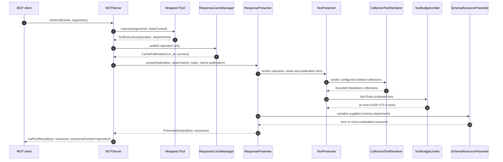

<!-- docs/reference/presentation_architecture.md -->
<!-- template=reference version=064954ea created=2026-08-19T19:43Z updated=2026-09-13 -->
# Presentation Architecture and Resource Delegation

**Status:** DEFINITIVE  
**Version:** 2.4.0  
**Last Updated:** 2026-10-18

**Configuration basis:** [presentation.yaml](../../.pgmcp/config/defaults/presentation.yaml)  
**Composition root:** [bootstrap.py](../../mcp_server/bootstrap.py)  
**Presenter implementation:** [mcp_server/presenters](../../mcp_server/presenters)

---

## Purpose

The operation DTO owns the complete tool-result facts. MCPServer serializes that
actual DTO as MCP `structuredContent`; the presentation layer produces a bounded,
actionable Markdown projection and supplied schema attachments. The Resource cache
retains the operation through its existing canonical serialization policy.
Presentation configuration owns wording, field selection, ordering and per-tool item
limits. Generic Python components own rendering mechanics, startup validation and the
final text byte ceiling.

These outputs serve complementary purposes:

1. compact text supports routine decisions;
2. `structuredContent` supplies the actual operation DTO, serialized by the server with
   JSON mode and aliases, independently of text truncation or cache publication;
3. `pgmcp://cache/runs/{run_id}` supplies the cached operation and bounded reads when
   clients need that route for complete fields or verbose diagnostics.

Schema exposure follows the registered tool's available output-model metadata.
Processing or transport failures without an operation DTO remain explicit errors;
structured data is never reconstructed from presented Markdown.

Schema attachments travel separately in the internal
[ToolExecution](../../mcp_server/core/tool_execution.py) carrier. Cache publication stores
only its operation DTO; text presentation receives that DTO, notes and publication facts.
The resource presenter receives only attachments. The whole-tool input error DTO retains
its existing `input_schema` field, while its explicit attachment supplies
`schema://validation`. An attachment does not otherwise enter the cached operation.

## End-to-End Flow



The DTO is published before presentation. Collection limits and text truncation therefore
never remove fields or items from the cached representation or the server-owned
structured operation.

## Ownership Boundaries

| Concern | Authoritative owner |
|---|---|
| Tool result semantics and complete data | Frozen tool-output DTO |
| Operation DTO serialization into MCP structuredContent | MCPServer |
| Cached operation representation and bounded reads | MCP Resource cache |
| Attachment identity and schema facts | Producer of `SchemaAttachment` |
| Attachment URI, media type and schema serialization | `SchemaResourcePresenter` |
| Per-tool wording, scalar selection, collection declarations, headings, order, and item limits | `presentation.yaml` |
| Configuration shape | `PresentationConfig` and its nested frozen schemas |
| Supported tool identity and output model | Runtime-derived `SupportedToolContract` catalog |
| Settings-dependent exposed tools | `ToolAssembly.active_tools` |
| Scalar/list/tuple formatting | `SafeNoneFormatter` |
| Ordered collection rendering | `CollectionTextRenderer` |
| Final text ceiling | `TextBudgetLimiter` |
| Composition of text and embedded schema resources | `ResponsePresenter` |

Business logic, managers, adapters, and domain validation services do not construct
user-facing presentation strings.

## Runtime Tool Catalog

`ServerBootstrapper` constructs a `ToolAssembly` with the supported tool contracts and
the settings-dependent active tools exposed to the MCP client. The supported contract
catalog is derived from the constructed tool instances and their concrete output models;
it is not a second static tool list. Read current tool names and schemas from the live
server composition. Credential settings may change which tools are active without
changing what the build supports.

## Declarative Presentation Configuration

`presentation.yaml` contains one entry for every supported tool and global formatting
policy. A tool entry can use:

| Field | Purpose |
|---|---|
| `template_success` / `template_failure` | Scalar Markdown projection for the normal result envelope |
| `max_items` | Shared bound for inline scalar sequences and every configured collection depth |
| `collections` | Ordered `list[T]` or variadic `tuple[T, ...]` projection declarations |
| `collections[].children` | Recursive projection of direct ordered-sequence fields on model items |
| `enum_cases` | Additional configured text selected by a serialized enum value |
| `next_instructions` | Configured follow-up text, such as context reload reminders |
| note groups | Configured exclusion, suggestion, recovery, and information messages |

Global formatting defines the None placeholder, sequence separator, item-omission text,
collection-omission text, truncation notices, and the byte ceiling.

### Ordered Sequences

Only exact `list[T]` and variadic `tuple[T, ...]` annotations are supported. `T` must be a
scalar (`str`, `int`, `float`, `bool`, or enum) or a Pydantic model. Arbitrary iterables,
mappings, sets, sorting, filtering, and tool-specific renderer branches are deliberately
unsupported.

Flat scalar sequences may appear directly in an ordinary template, for example issue
labels. Structured sequences use a collection declaration with an optional heading and
an item template. Child collections are evaluated depth-first. Every level preserves DTO
order and applies the tool's `max_items` independently.

Example:

```yaml
list_issues:
  category: query
  max_items: 10
  template_success: "Found {issues_count} issues matching criteria."
  collections:
    issue_rows:
      order: 10
      field: issues
      heading: "Issues:"
      item_template: >-
        - #{number} [{state}] {title} — {html_url} |
        labels: {labels} | assignees: {assignees_summary} | created: {created_at}
```

Collection, child and enum-case declarations use mapping-key identities and unique
sibling order ranks. DTO item order is separate and remains unchanged. See
[configuration composition](config-loading-architecture.md) for source overrides.

When more than ten issues exist, the text adds an omission line. All issues remain in the
cached `ListIssuesOutput` DTO.

### Runtime Shape Rules

On a successful output, a configured collection must exist and must have the configured
list/tuple and item shape. Missing fields, wrong container types, wrong item types, or
missing item placeholders raise `ConfigError` with field/path context. Generic failure
envelopes may omit success-only collections; the presenter does not fabricate them.

## Startup Validation

`validate_presentation_alignment` runs during server bootstrap against the complete
supported catalog. Startup fails fast when:

- a supported tool lacks a presentation entry or configuration names an unknown tool;
- a tool name is duplicated or its concrete output model cannot be resolved;
- a template placeholder is absent from the tool's DTO or uses a forbidden generic
  presentation field;
- a configured collection is not a supported ordered-sequence field, has invalid item
  placeholders, or declares an invalid child;
- an enum case targets a non-enum field or unknown value;
- a bounded sequence has no `max_items`, or `max_items` exists without a bounded sequence;
- global formatting cannot preserve the mandatory truncation notice and fixed-shape
  cache reference within the configured budget.

This validation uses the same runtime-derived contracts that drive tool activation. It
therefore avoids a second catalog source of truth while validating inactive supported
tools as well as active ones.

## Final UTF-8 Byte Ceiling

The global `max_text_response_bytes` value is `8000`. `TextBudgetLimiter` is the final
step after scalar templates, enum blocks, collections, instructions, notes, cache-failure
fallbacks, and the cache reference have been composed.

- Under-budget text is returned byte-for-byte unchanged.
- Over-budget text is truncated on a UTF-8-safe boundary, preferring complete Markdown
  blocks or lines.
- If truncation intersects a fenced code block, the limiter closes the fence when the
  budget permits.
- A truthful truncation notice and one complete cache reference are reserved when cache
  publication succeeded.
- If cache publication failed, the limiter uses the configured cache-failure notice
  without inventing a resource. Server-owned `structuredContent` still contains the
  returned operation DTO, even when retained text fallbacks describe cache-related
  unavailability.

The byte ceiling applies to every tool's presented text. It does not truncate
`structuredContent` or schema attachments. Individual tools configure item limits,
not their own text budgets.

## Cache Serialization and Attachment Ownership

[CachedResponseResource](../../mcp_server/resources/cache.py) serializes the operation
using its canonical Pydantic field contract. Required nullable fields retain `null`.
Explicitly supplied optional nulls also remain present; only unset optional null fields
are omitted. Non-null defaults retain their existing representation. The rule follows
the actual nested DTO and selected union variant through models, mappings and sequences.
Ordinary JSON values, including null, false, zero and empty containers, are preserved.

Complete reads and bounded Unicode-codepoint windows use the same serialized operation.
The hash identifies that complete UTF-8 representation. Cache eviction, cache misses,
and publisher/read interface separation are unchanged; a resource read never replays
the producing operation.

[SchemaResourcePresenter](../../mcp_server/presenters/schema_resource_presenter.py)
dispatches on attachment identity, without inspecting operation classes or querying
the catalog:

| Attachment identity | URI | Media type |
|---|---|---|
| Whole-tool input schema | `schema://validation` | `application/json` |
| Selected template context | `schema://template/<percent-encoded-template-id>/context` | `application/schema+json` |

Template identity denotes the active catalog contract, not retained version history.
The response carries the complete embedded schema. This transport capability does not
activate a new template suite or change which attachments existing tools produce.
MCP `isError` continues to derive from operation success.

## Cache and Client Guidance

The inline projection is sufficient when it contains the information needed for the
current action. Use the provided `structuredContent` when additional operation fields
or captured diagnostics are needed and the client exposes them. Read the cached resource
when that route or bounded paging is needed. Examples include complete Git output, diffs,
test/check/fix result records and captured evidence, and resolved context schemas.

Do not parse presented Markdown to reconstruct DTO data. Both structured operation
and cached data follow the DTO contract and its bounded capture. Wire serialization
uses JSON mode with aliases; the cache's canonical policy defines its field
presence for unset optional nulls. They represent the same operation, not a promise
of byte-identical JSON.
For large results, follow the configured cache-reading hint and packaged cache-reading
guide; it describes safe windows and integrity checks without replaying a mutation.

`scaffold_schema` also supplies its selected context schema as a separate schema
attachment. The operation DTO and attachment have separate ownership and serialization
paths.

## Configured Execution Evidence

The V3 execution tools use the same generic presentation and cache path as other tools.
`run_checks`, `run_tests`, and `apply_fixes` return their factual operation DTOs;
configured templates render bounded result rows while the cache retains the full serialized
DTO. Result order follows the operation contract. Presentation limits and the final
8,000-byte ceiling affect only inline text.

The operation envelope and the native outcome answer different questions. Inspect
`success` and any `error_code` for operation or consumer failures; inspect each
result's status, reason, evidence, adapter identity, and bounded capture for observed
native work. A check or test can report a substantive failed result without that result
being converted into a protocol error. An unavailable adapter, rejected internal request,
interruption, or unconfirmed termination remains an operational fact. Do not infer
success from a heading or from the absence of an inline diagnostic.

`apply_fixes` applies selected fixes in request order and stops when work cannot continue
or a selected fix does not pass. Earlier native changes may already have occurred. Its
result rows distinguish completed work from unavailable or not-executed work; the
operation does not promise rollback. Inspect affected files, then choose an authorized
narrow recheck or recovery. The system does not automatically chain fixes and checks.

The complete operation DTO is published before presentation. Use the cached resource
when you need result fields or evidence omitted by the bounded text, and do not reconstruct
those facts from Markdown.

## Primary Implementation and Evidence

- [Structured tool-output schemas](../../mcp_server/schemas/tool_outputs.py)
- [Check, test, and fix tools](../../mcp_server/tools/check_tools.py), [run tests](../../mcp_server/tools/run_tests_tool.py), and [apply fixes](../../mcp_server/tools/fix_tools.py)
- [Presentation configuration schema](../../mcp_server/config/schemas/presentation_config.py)
- [Text presenter and startup alignment](../../mcp_server/presenters/text_presenter.py)
- [Collection renderer](../../mcp_server/presenters/collection_text_renderer.py)
- [Text budget limiter](../../mcp_server/presenters/text_budget_limiter.py)
- [Response presenter](../../mcp_server/presenters/response_presenter.py)
- [Schema resource presenter](../../mcp_server/presenters/schema_resource_presenter.py)
- [Presentation composition tests](../../tests/mcp_server/unit/presenters/test_text_presenter_composition.py)
- [Presentation rollout tests](../../tests/mcp_server/unit/config/test_tool_presentation_rollout.py)

## Related Documentation

- [MCP tools navigation](tools/README.md)
- [Quality and validation tools](tools/quality.md)
- [Discovery and admin tools](tools/discovery.md)
- [Architecture principles](../coding_standards/ARCHITECTURE_PRINCIPLES.md)

---

## Version History

| Version | Date | Author | Changes |
|---|---|---|---|
| 2.3.0 | 2026-09-24 | @imp | Align execution evidence and runtime catalog guidance with the V3 check/test/fix surface |
| 2.1.0 | 2026-08-22 | Agent | Document nested structured quality-gate findings and complete cached evidence |
| 2.2.0 | 2026-09-13 | Agent | Document operation/attachment transport and required-null cache fidelity |
| 2.0.0 | 2026-08-22 | Agent | Document bounded declarative projection, runtime catalog alignment, ordered collections, and final byte limiting |
| 1.1.0 | 2026-08-19 | Agent | Document composite text and validation-resource presentation |
| 2.4.0 | 2026-10-18 | @imp documenter | Document server-owned structured operation delivery, SDK2 ownership and retained cache/attachment semantics. |


